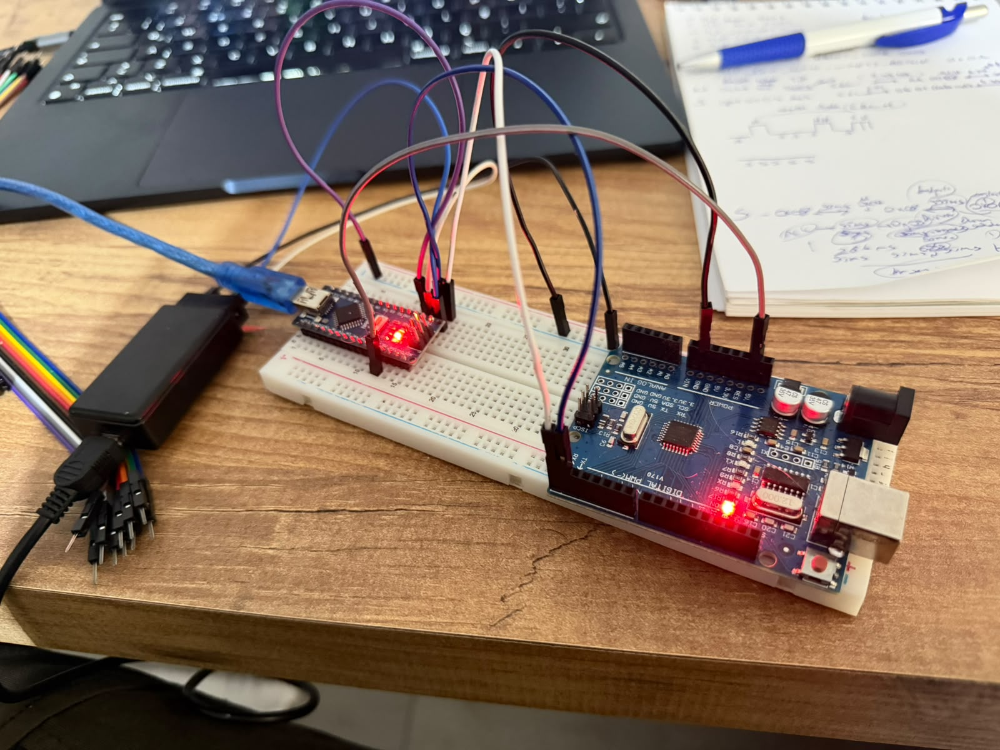
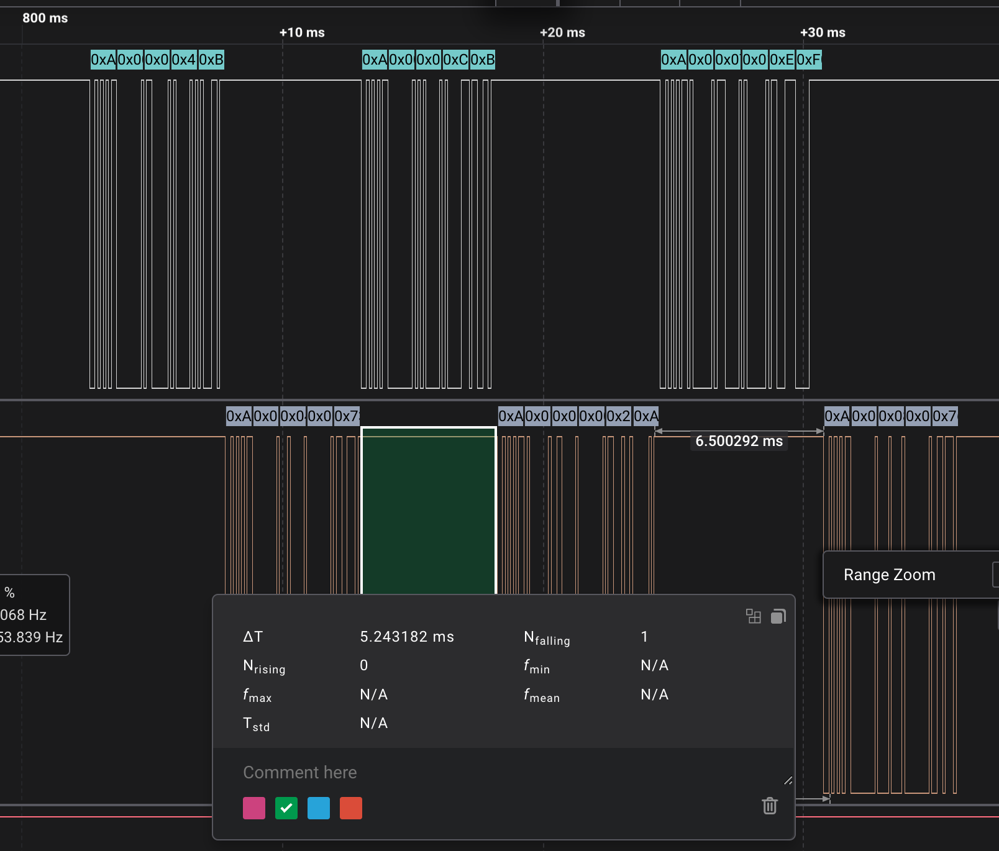
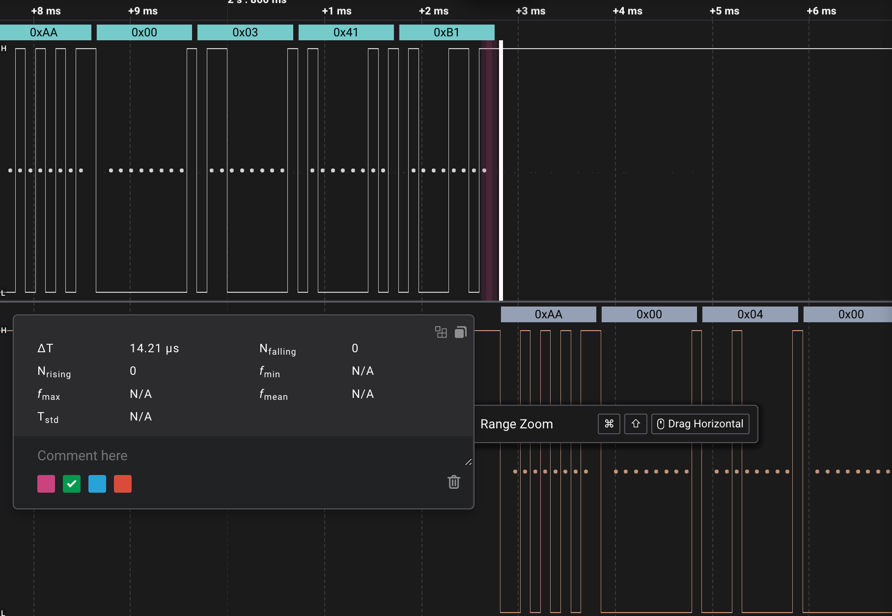
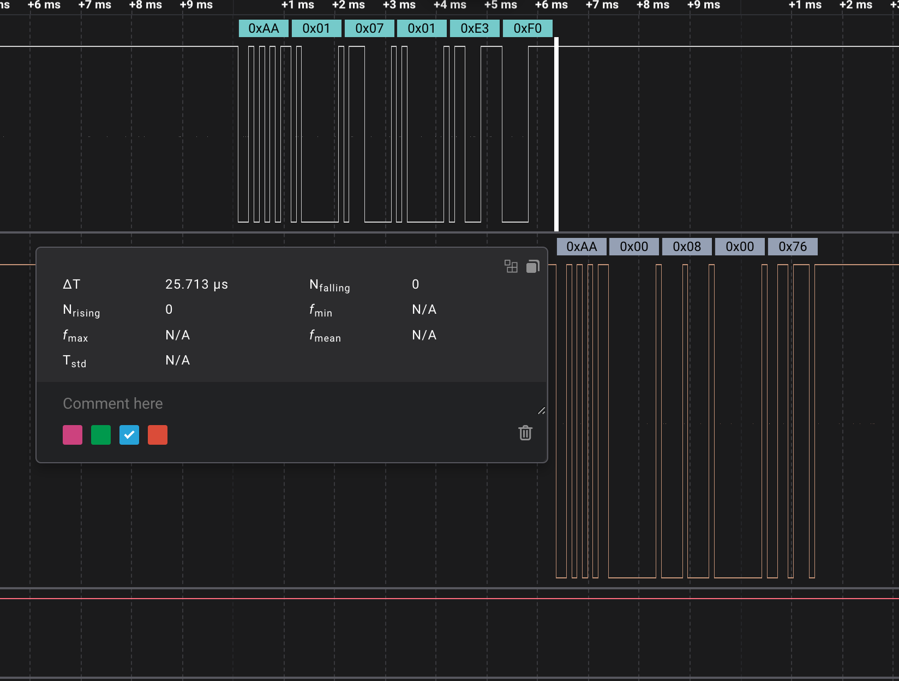
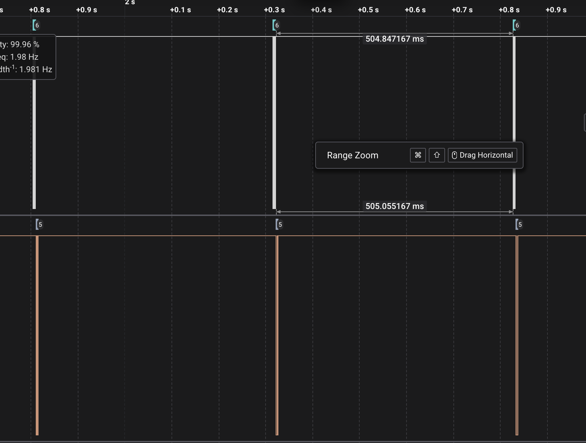
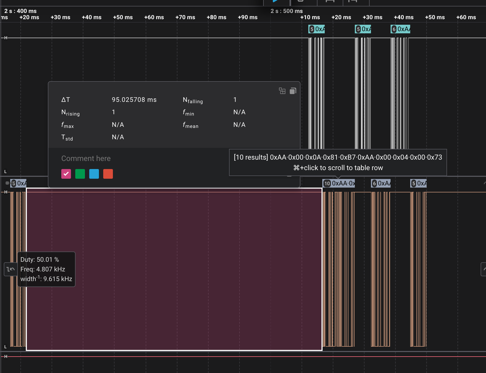

# 03 – Binary Paket Protokolü + İki Arduino Testi

ATmega328p için **register seviyesinde** yazılmış, CRC-16 korumalı bir binary paket protokolü. Önce bilgisayarla (Python) test edildi, sonra iki Arduino (Nano + Uno) arasında master–slave olarak çalıştırılıp lojik analizörle ölçüldü.

[01-nmea-dogrulama](../01-nmea-dogrulama)'daki kesmeli UART sürücüsü ve [02-nmea-ayristirma](../02-nmea-ayristirma)'daki Timer0 tick'i üzerine kuruludur.



## Neden binary?

NMEA metin tabanlıdır: `$` ile başlar, `\n` ile biter, checksum sadece XOR. Binary veride bu işe yaramaz, çünkü veri her değeri taşıyabilir (`0x00`, `0x0A` dahil). Bu yüzden:

- Satır sonu yerine **uzunluk alanı** var
- `strlen`, `strtok` gibi string fonksiyonları kullanılmıyor
- XOR yerine **CRC-16/MODBUS** var (karakter yer değiştirmelerini de yakalar)

## Paket yapısı

```
| 0xAA | UZUNLUK | TİP | VERİ (0–32) | CRC_L | CRC_H |
```

| Alan | Açıklama |
|---|---|
| `0xAA` | Başlangıç baytı |
| `UZUNLUK` | Sadece VERİ'nin bayt sayısı (0–32) |
| `TİP` | Komut numarası |
| `CRC` | UZUNLUK + TİP + VERİ üzerinden CRC-16/MODBUS. Önce düşük bayt |

Çok baytlı sayılar little-endian gönderilir ve kaydırma ile ayrılır (`(t >> 8) & 0xFF`).

## Modüller

```
uart.c           donanım + halka tamponlar. Paketi bilmez.
binary_packet.c  paket oluşturma ve okuma (durum makinesi). UART'ı ve timer'ı bilmez.
crc.c            sadece CRC-16 hesaplar.
main.c           hepsini birbirine bağlar.
```

`binary_paket_oku()` zamanı parametre olarak alır, timer'ı kendisi çağırmaz. Bu sayede modül bilgisayarda gcc ile, Arduino olmadan test edilebilir.

## RX: Paket alma

Durum makinesi **main'de** çalışır, ISR'da değil:
- CRC hesabı ISR için fazla uzun
- Main gecikse bile halka tampon baytları korur (9600 baud'da ~130 ms)
- Durumu sadece main değiştirdiği için `cli()` gerekmez
- Paket bayrakla değil, **dönüş değeriyle** teslim edilir (`return 1`), böylece bayrak yarışı oluşmaz

```
BASLANGIC_BEKLE → UZUNLUK_BEKLE → TIP_VE_VERI_TOPLA → CRC_L_BEKLE → CRC_H_BEKLE
       ↑                                                              │
       └─────────── CRC tuttu: paket teslim / tutmadı: hata++ ────────┘
```

- Veri toplarken gelen `0xAA` veri sayılır, başlangıç sayılmaz
- Senkron kaybolursa uzunluk > 32 olur ya da CRC tutmaz. Paket atılır ve sistem kendini toparlar
- **50 ms bayt arası zaman aşımı:** Yarım kalan paket atılır

## Test 1 – Bilgisayar (Python)

| Test | Gönderilen | Sonuç |
|---|---|---|
| LED aç | `AA 01 01 01 E0 50` | LED yandı, aynı paket geri geldi ✓ |
| LED kapat | `AA 01 01 00 21 90` | ✓ |
| PING | `AA 00 02 80 71` | 4 baytlık uptime döndü ✓ |
| Bozuk CRC | son bayt değiştirildi | Cevap yok, hata sayacı arttı ✓ |
| Önce çöp, sonra LED | `12 34 AA FF` + LED paketi | LED paketi yine tanındı ✓ |

## Test 2 – İki Arduino (master–slave)

**Kurulum:** Uno (master) TX → Nano (slave) RX, Nano TX → Uno RX, ortak GND. İkisi de USB'den besleniyor. Saleae Logic 2 ile iki hat izlendi (9600 8N1).

### Protokol

| TİP | Ad | Yön | Veri |
|---|---|---|---|
| 0x03 | BEGIN | M → S | – |
| 0x04 | ACK | S → M | – |
| 0x05 | LED_INT | M → S | – (LED ne durumda?) |
| 0x06 | LED_STATE | S → M | 1 bayt: 0/1 |
| 0x07 | LED_SET | M → S | 1 bayt: 0/1 |
| 0x08 | LED_OK | S → M | – |
| 0x09 | HASNT_COME | S → M | – (sorgu gelmedi) |
| 0x0A | SLAVE_WANTS_BEGIN | S → M | – |

Normal akış: `BEGIN → ACK → LED_INT → LED_STATE → LED_SET → OK → (500 ms) → LED_SET → OK …`



### Durum makinesi kalıbı: GÖNDER / BEKLE

- **GÖNDER:** Tek turda çalışır, paketi gönderir, saati kurar, BEKLE'ye geçer
- **BEKLE:** Önce "cevap geldi mi?", sonra "süre doldu mu?" diye bakar. Süre dolarsa aynı paket tekrar gönderilir. 3 denemeden sonra bağlantı baştan kurulur

| Bekleme | Süre | Gerekçe |
|---|---|---|
| Master: cevap bekleme | 100 ms | Cevap normalde µs'ler içinde geliyor |
| Master: bağlantı bekleme | 300 ms | |
| Slave: komut bekleme | 600 ms | Master 500 ms'de bir gönderiyor. Zaman aşımı bundan biraz uzun olmalı |

### Ölçümler

| Ölçüm | Değer |
|---|---|
| Bit süresi | 104 µs (9600 baud), 1 bayt = 1,042 ms |
| Slave tepki süresi: BEGIN → ACK | **~13 µs** |
| Slave tepki süresi: LED_SET → OK | **~26 µs** |
| Komutlar arası | ~505 ms |

Tepki süresi, master'ın son baytının stop biti bittiği an ile slave'in ilk start bitinin düştüğü an arasında ölçüldü. Son bitler 1 olduğunda görünen bir kenar olmadığı için baytın sonu, start bitinin düşen kenarından itibaren 10 bit × 104 µs eklenerek bulundu.



**İki tepki süresi neden farklı?** BEGIN'de slave cevabı **aynı döngü turunda** gönderiyor. LED_SET'te önce `KOMUT_ONAYLANDI` durumuna geçiyor, OK **bir sonraki turda** gidiyor. Ayrıca CRC 2 yerine 3 bayt üzerinden hesaplanıyor. Durum makinesindeki her ara durum cevabı bir döngü turu geciktiriyor.





### Yarış durumu

Master kablosu çıkarılıp geri takılınca iki taraf aynı anda bağlantıyı başlatmaya çalıştı: slave'in zaman aşımı dolup `0x0A` gönderdiği sırada master'ın BEGIN'i geliyordu. Slave'in TX tamponunda iki paket arka arkaya gitti:

```
AA 00 0A 81 B7  AA 00 04 00 73
  SLAVE_WANTS_BEGIN     ACK
```

Master bağlantı beklerken sadece ACK'ya baktığı için `0x0A`'yı görmezden geldi ve bağlantı sorunsuz kuruldu. Ama bu durum, slave'in kendiliğinden konuşmasının bir riskini gösteriyor: Modbus gibi protokollerde slave sadece sorulunca cevap verir.



## Öğrenilenler

**Lojik analizörle bulunan hata: sayaç sıfırlanmıyordu.**
Slave'in "bağlantı bekle" penceresi 300 ms olmalıydı, ama ölçümde ilk seferde 100 ms sürdüğü görüldü (600 + 100 = 700 ms). Sebep: önceki durumdan sayaç 3'te kalıyordu. Yeni durumda 1 deneme sonra sayaç 4 oluyor, bu da hemen eşiği geçiyordu. Bunu LED'e bakarak görmek mümkün değildi, sadece süreler ölçülünce ortaya çıktı.
→ **Kural:** Bir duruma girerken o duruma ait sayaç sıfırlanmalı.

**Tekrar denemede komut tersine dönüyordu.**
Master, LED_SET'i her gönderişte `^= 1` yapıyordu. OK cevabı kaybolursa tekrar deneme "LED'i 1 yap" yerine "LED'i 0 yap" gönderiyordu.
→ Tekrar deneme **aynı** paketi gönderir. Değer sadece onay gelince değişir (idempotent komut).

**Zaman aşımından sonra saat yenilenmiyordu.**
`if (simdi - gonderim_ms >= 100)` bir kez doğru olunca her turda doğru kalıyordu ve sayaç 300 ms yerine birkaç µs içinde 3 oluyordu.
→ Zaman aşımında ya durum değişmeli ya da `gonderim_ms = simdi` yapılmalı.

**Diğer hatalar:**
- `if (rb_veri_var)`: parantez yok, fonksiyonun adresi her zaman doğru
- `DDRB` ile `PORTB` karıştırıldı: LED hiç yanmadı
- Enum değerleri açıkça yazılmadığında hattaki tip numaraları iki tarafta farklı çıkabilir. Değerler hep açıkça yazılmalı (`TIP_BEGIN = 0x03`)
- RX'te "sayaç doldu mu?" kontrolü bir bayt geç yapılınca CRC_L kayboluyordu

## Sonraki adım

- [x] `01-nmea-dogrulama`
- [x] `02-nmea-ayristirma`
- [x] `03-binary-paket`: CRC-16, paket protokolü, iki Arduino testi
- [ ] `04-modbus-slave`: Modbus RTU slave, register tablosu, pymodbus ile test
