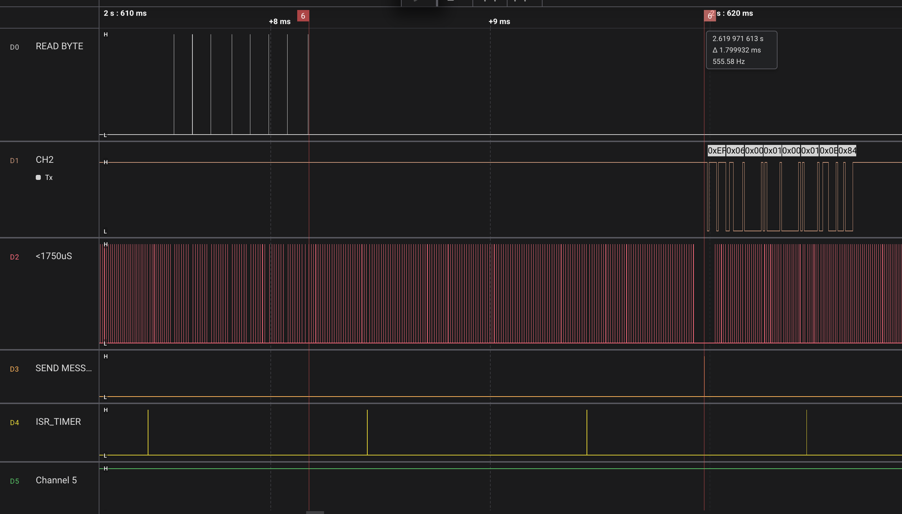
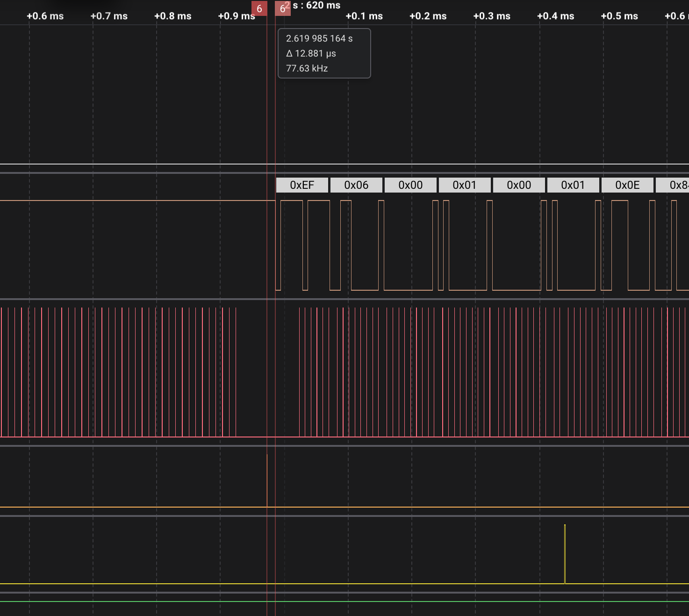
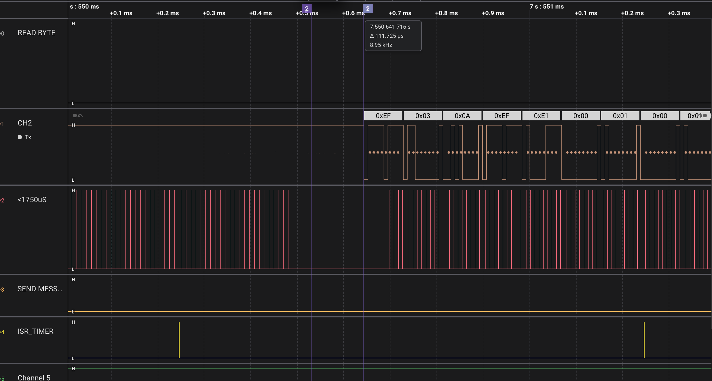
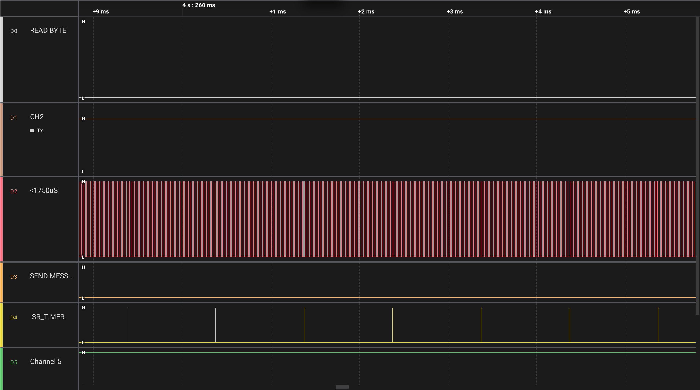
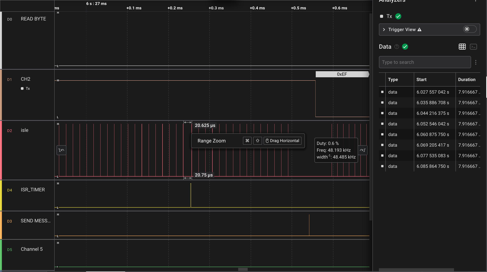
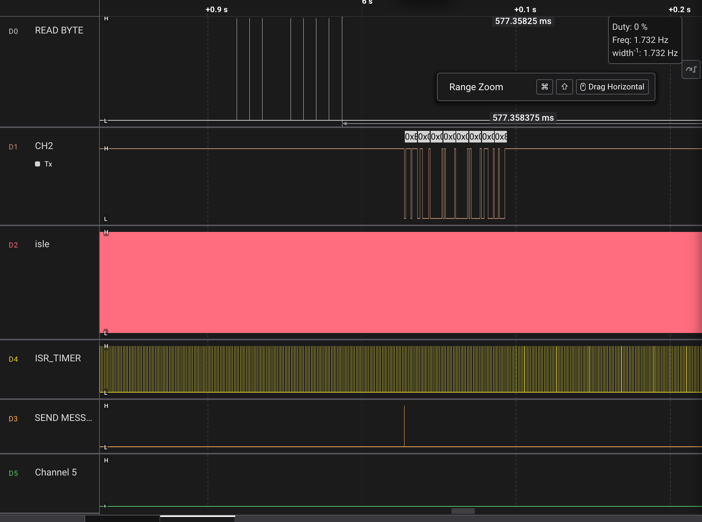
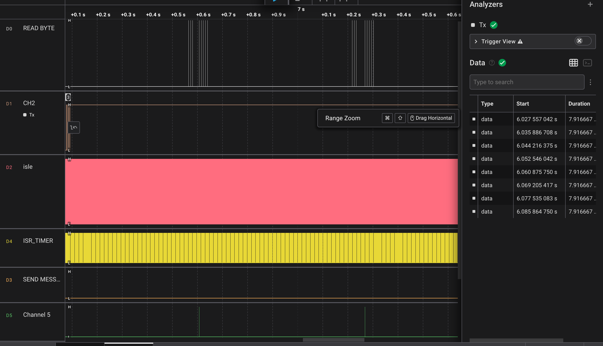
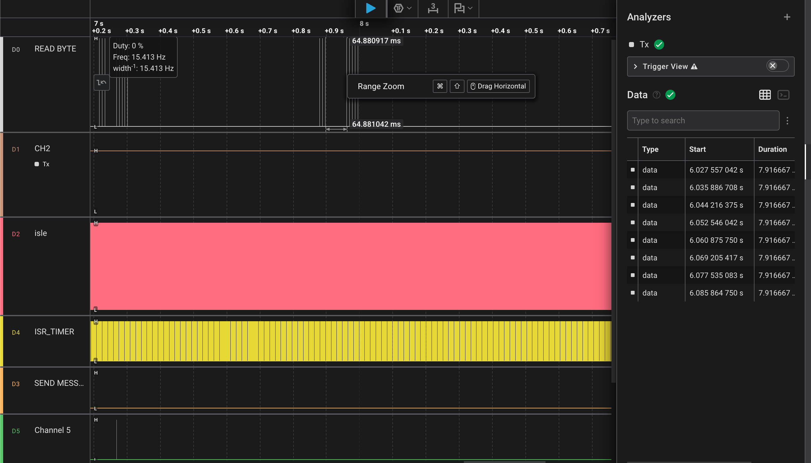
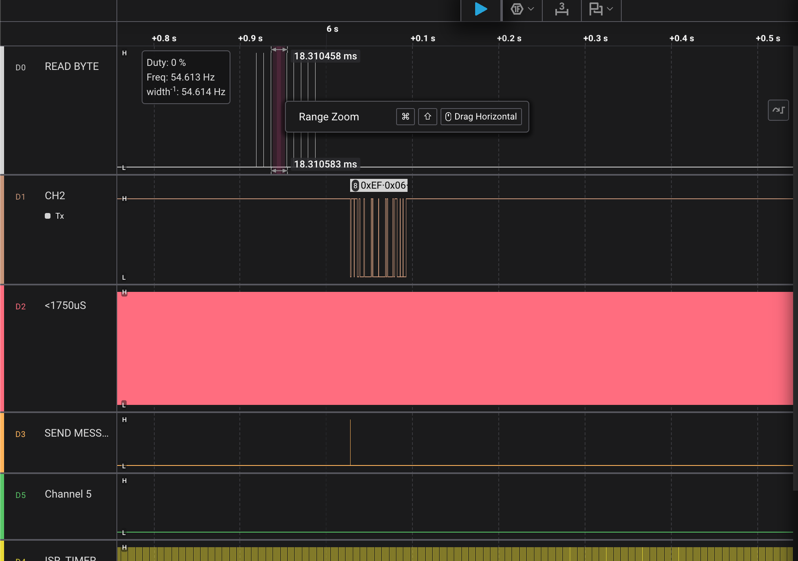

# 04/02 – µs Zamanlamalı Modbus RTU Slave

04/01'deki slave artık **115200 baud**'da çalışıyor. Paket sınırlarını 1 ms'lik tick yerine **µs hassasiyetinde** ölçüyor. t1.5 ve t3.5 süreleri koda sabit yazılmıyor, **baud'dan hesaplanıyor**. Bu sayede aynı kod 1200, 9600 ve 115200'de standarda uygun çalışıyor. UART ve Modbus, struct tabanlı birbirinden bağımsız iki modüle ayrıldı. Bütün zamanlama, debug pinleri ve lojik analizörle ölçülerek doğrulandı.

[01-basic-modbus](../01-basic-modbus)'un üzerine kuruludur.

> [!NOTE]
> Bu adımın adı `eeprom-microus-modbus`. Zamanlama kısmı tamamlandı, **EEPROM kısmı henüz yapılmadı** (bkz. [Sonraki adımlar](#sonraki-adımlar)).

---

## İçindekiler
1. [115200 baud](#1-115200-baud)
2. [µs hassasiyetinde zamanlama](#2-µs-hassasiyetinde-zamanlama)
3. [Mimari](#3-mimari)
4. [Ölçüm yöntemi: debug pinleri](#4-ölçüm-yöntemi-debug-pinleri)
5. [Ölçümler](#5-ölçümler)
6. [t1.5 testi](#6-t15-testi)
7. [Öğrenilenler](#7-öğrenilenler)
8. [Bilinen sınırlamalar](#8-bilinen-sınırlamalar)
9. [Sonraki adımlar](#sonraki-adımlar)

---

## 1. 115200 baud

UART baud'u, 16 MHz'lik saatin bir bölücüyle (UBRR) bölünmesiyle elde ediliyor:

```
normal:  UBRR = F_CPU / (16 · baud) − 1
U2X:     UBRR = F_CPU / (8  · baud) − 1
```

UBRR bir tam sayı olmak zorunda. 115200 için normal modda sonuç 7,68 çıkıyor ve **8**'e yuvarlanıyor. Bu da gerçekte ~111 111 baud demek, yani −%3,5 hata. Bu hata alıcının tolere edebileceği sınıra çok yakın. **U2X** (çift hız) modunda bölücü 8 olduğu için UBRR **16** çıkıyor ve hata +%2,1'e iniyor.

| | Normal (÷16) | U2X (÷8) |
|---|---|---|
| UBRR | 8 (7,68 → yuvarlandı) | 16 |
| Gerçek baud | 111 111 | 117 647 |
| Hata | −%3,5 | +%2,1 |

Yuvarlama makroda yapılıyor: bölmeden önce bölenin yarısı ekleniyor. U2X makrosunda bölen `8·baud` olduğu için eklenecek yarı `4·baud`. İlk sürümde yanlışlıkla `8·baud` yazılmıştı ve UBRR 16 yerine 17 çıkıyordu.

```c
#define UBRR_DEGER_HESAPLAMA(baud) ((((F_CPU + 8UL * (baud))/(16UL * (baud))) - 1))

#define UBRR_DEGER_U2X_HESAPLAMA(baud) ((((F_CPU + 4UL * (baud))/(8UL * (baud))) - 1))
```

**Ölçülen:** Analizörde baytlar arası süre **85,25 µs** çıktı (10 bit). Bu ~117 300 baud demek, hesaplanan değerle uyumlu.

---

## 2. µs hassasiyetinde zamanlama

Modbus RTU'da paketin başını ya da sonunu gösteren özel bir bayt yok. Paketin sonunu **sessizlik** belirliyor: hat **3,5 karakter** süresi boyunca boş kalırsa paket bitmiş sayılıyor.

| | Ne ölçer? | Aşılırsa |
|---|---|---|
| **t1.5** | Paketin içindeki iki bayt arası en uzun sessizlik | Paket bozuk sayılır, t3.5'ten sonra atılır |
| **t3.5** | Paketin bittiğini gösteren sessizlik | Paket kapanır, uzunluk / adres / CRC kontrolüne gider |

- **t1.5:** Paketin **içindeki** iki bayt arasında izin verilen en uzun sessizlik. Aşılırsa paket bozuk sayılır ve atılır.
- **t3.5:** Paketin **bittiğini** gösteren sessizlik. Dolunca paket uzunluk, adres ve CRC kontrollerinden geçer. Ya işlenir ya da atılır.

### Baud'a göre süreler

Modbus bir karakteri **11 bit** sayar: start + 8 veri + parite + stop. Parite kullanılmazsa yerine ikinci bir stop biti gelir. Hatta giden gerçek bayt 8N1'de 10 bit olsa da, hesapta 11 bit kullanmak süreleri biraz uzatır, yani güvenli taraftadır.

```
karakter = 11 · 1 000 000 / baud    (µs)

baud ≤ 19200:   t1.5 = 1,5 · karakter      t3.5 = 3,5 · karakter
baud > 19200:   t1.5 = 750 µs (sabit)      t3.5 = 1750 µs (sabit)
```

**19200'ün üstünde neden sabit?** Baud yükseldikçe 3,5 karakter çok kısalıyor. 115200'de sadece ~334 µs kalıyor. Bu kadar kısa bir sessizliği güvenilir şekilde ölçmek işlemciye yük bindirir. Master'ın (özellikle PC + USB dönüştürücü) baytlar arasına bıraktığı küçük boşluklar da yanlışlıkla "paket bitti" diye algılanabilir. Standart bu yüzden yüksek hızlarda sabit bir alt sınır koyuyor.

| Baud | 1 karakter | t1.5 | t3.5 |
|---|---|---|---|
| 1200 | 9 166 µs | 13 750 µs | 32 083 µs |
| 9600 | 1 146 µs | ~1 717 µs | ~4 010 µs |
| 115200 | — | 750 µs (sabit) | 1 750 µs (sabit) |

Hesap tam sayılarla yapılıyor. Çarpma taşmasın diye `UL` ekleniyor, 3,5 için de `× 35 / 10` yazılıyor (önce çarp, sonra böl).

### Boşluk bölgeleri

```
0 ─────────── t1.5 ─────────────────── t3.5 ──────────→  baytlar arası boşluk
  normal paket  │   bozuk paket:           │  paket bitti:
  devam ediyor  │   bayrak kalkar, paket   │  uzunluk / adres / CRC
                │   t3.5'i bekleyip atılır │  kontrolüne gider
```

Ortadaki bölgede paket hemen atılmıyor. Önce bayrak kaldırılıyor, t3.5 bekleniyor, sonra atılıyor. Paket hemen atılsaydı paketin geri kalan baytları **yeni bir paketin ilk baytı** sanılırdı.

---

## 3. Mimari

```
uart.c   ── donanım: UBRR, register'lar, RX/TX kesmeleri, halka tamponlar
modbus.c ── protokol: zamanlama, çerçeve, CRC, register tablosu
main.c   ── ikisini birbirine bağlar, aralarında sayıları (bayt, zaman, baud) taşır
```

| Dosya | Ne biliyor? | Ne bilmiyor? |
|---|---|---|
| `uart.c` | Register'lar, UBRR, kesmeler, halka tamponlar | Modbus'ı |
| `modbus.c` | Baud ve zaman (sayı olarak), çerçeve, CRC, register tablosu | UART'ı, timer'ı |
| `main.c` | İki modülün `Usart` / `Modbus` kapılarını | Modüllerin içini |

### Struct ile tek kapı

Her modül dışarıya tek bir `const` struct nesnesi açıyor. `.h`'da struct'ın tipi ve `extern` bildirimi var. Nesnenin kendisi ve fonksiyonlar `.c`'de. Fonksiyonlar `static`, yani başka dosyalardan isimleriyle çağrılamıyor. Dışarıya sadece adresleri, struct'ın içinden açılıyor.

```c
// uart.h
typedef struct {
    void    (*init)(uint32_t baud);
    void    (*send_data)(const uint8_t *veri, uint8_t n);
    uint8_t (*ring_buffer_not_empty)(void);
    uint8_t (*ring_buffer_read_byte)(void);
    /* ... */
} Uart_t;
extern const Uart_t Usart;
```

```c
// main.c
#define BAUD 115200

Usart.init(BAUD);
Modbus.init(BAUD);
sei();

while (1) {
    uint32_t simdi = getTickinMicro();
    while (Usart.ring_buffer_not_empty())
        Modbus.bayt_al(Usart.ring_buffer_read_byte(), simdi);
    uint8_t n = Modbus.isle(simdi, cevap, getTickTime());
    if (n) Usart.send_data(cevap, n);
}
```

Dosya içinde paylaşılan durum (`tampon`, `bayt_sayaci`, `son_byte_us`, `t15_us`, `t35_us`) **dosya `static`**'i. Sadece tek fonksiyonda kullanılan değerler (`uzunluk`, `ubrr`) **yerel**.

> [!TIP]
> `modbus.c`, `uart.h`'ı include etmiyor. Baud'u bir **sayı** olarak alıyor, zamanı da `simdi` parametresiyle. Modbus UART'a değil, sadece sayılara bağımlı. Bu yüzden bilgisayarda gcc ile test edilebiliyor. STM32'ye geçince `uart.c` tamamen değişecek, `modbus.c`'ye dokunulmayacak.

---

## 4. Ölçüm yöntemi: debug pinleri

**Debug palsi**, kodun belli bir satırına koyulan kısa bir H → L geçişi. Analizörde ince bir çizgi olarak görünüyor ve "kod tam şu an bu satırdan geçti" anlamına geliyor.

Başta istekleri RX hattından izlemek istedim, ama RX analizörde görünmedi. Debug pinleri daha iyi bir şey de sağladı: hatta **ne geçtiğini** değil, **MCU'nun ne karar verdiğini** ve **kesmelerin ne zaman çalıştığını** gösteriyorlar.

| Pin | Kanal | Ne zaman pals? |
|---|---|---|
| B0 | READ BYTE | `modbus_bayt_al` her bayt aldığında |
| B1 | ISLE | `modbus_isle`'ye her girişte (ana döngünün nabzı) |
| B2 | SEND MESSAGE | Adres ve CRC kontrolü geçildi, switch'e giriliyor |
| B3 | ISR_TIMER | Timer0 karşılaştırma kesmesi (1 ms) |
| B4 | t1.5 | t1.5 aşıldı, paket bozuk sayıldı |

Bir pals ~125 ns sürüyor. Analizörün örnekleme hızı düşükse palsi kaçırabiliyor: ilk denemede 8 bayttan 7'si görünmüştü.

---

## 5. Ölçümler

### Son bayttan cevaba



```
son bayt ──(A)── SEND MESSAGE ──(B)── ilk TX biti
```

| İstek | A | B |
|---|---|---|
| `06` LED yaz | 1,79 ms | ~15 µs |
| `03` 1 register | 1,79 ms | ~56 µs |
| `03` 5 register | 1,79 ms | ~100 µs |

**A sabit.** İçinde t3.5 sessizliği (1750 µs) ve isteğin CRC kontrolü var. Bütün istekler 8 bayt, CRC her seferinde 6 bayt üzerinden hesaplanıyor. Bu yüzden süre hep aynı. İsteğin içeriğine ilk kez switch'te bakılıyor, o da A'dan sonra geliyor.

**B değişiyor.** İçinde cevabın hazırlanması ve cevabın CRC'si var. Okunan register sayısı arttıkça cevap uzuyor, CRC de daha fazla bayt üzerinden hesaplanıyor. `06`'nın cevabı isteğin birebir kopyası olduğu için en hızlısı o.




Gecikmenin neredeyse tamamı, Modbus'ın zorunlu tuttuğu t3.5 sessizliğinden geliyor. Kod en kötü durumda ~100 µs harcıyor, yani toplamın ~%5'i. Burada CRC'yi hızlandırmanın (tablo yöntemi) anlamı yok. **Önce ölç, sonra optimize et.**

### Ana döngü ve kesmeler

| Ölçüm | Değer |
|---|---|
| Ana döngü turu (boşta) | ~9–10 µs |
| Ana döngü turu (bayt işlenirken) | ~16,4 µs |
| Timer0 ISR aralığı | 1,000 ms |
| ISR süresi | ~4,5 µs |
| UDRE kesmesinin döngüye etkisi | tur ~10 → ~13 µs (her baytın başında) |



Bir kesme main'i **herhangi bir yerde**, iki satırın arasında bile durdurabiliyor. Kesme debug palsinin H ve L satırları arasına denk gelince pin ISR bitene kadar yüksekte kalıyor, pals ~125 ns yerine ~4,5 µs sürüyor. Uzun pals aslında ISR'ın süresini ölçüyor.



Cevap gönderilirken ana döngü durmuyor. `send_data` baytları halka tampona koyup hemen dönüyor, baytları hatta UDRE kesmesi tek tek gönderiyor. Bu kesme her baytın başında bir kez çalışıyor ve o turu birkaç µs uzatıyor.

---

## 6. t1.5 testi

Testte paket ikiye bölünüyor: önce 3 bayt, araya bir boşluk, sonra kalan 5 bayt ([`t15_test.py`](t15_test.py)).

**`write()` ve `flush()`:** Python'da `s.write()` baytları hatta göndermiyor. Onları bilgisayarın gönderme tamponuna koyup hemen geri dönüyor, baytları USB çipi arkadan gönderiyor. Slave'deki `send_data` ile aynı mantık. `flush()` olmadan, 9600'de 3 baytın gönderilmesi 3,1 ms sürdüğü için 2,5 ms'lik `sleep` hatta hiç boşluk oluşturmadı. `s.flush()` "tampondaki her şey hatta gidene kadar bekle" demek. Ancak onunla gerçek bir boşluk oluşuyor.

**Neden 1200 baud?** Mac + USB dönüştürücü, `flush()` ile bile **~2,5 ms'den kısa** bir boşluk oluşturamıyor. 115200'de (t1.5 = 750 µs) ve 9600'de (t1.5 ≈ 1,7 ms) sınırın altına inilemiyor. 1200 baud'da bütün süreler büyüdüğü için sınırın iki tarafı da test edilebiliyor.

| Boşluk (`sleep`) | Gerçek boşluk | Bölge | t1.5 pini | Cevap |
|---|---|---|---|---|
| 3 ms | ✏️ | < t1.5 | — | ✅ geldi |
| 10 ms | ✏️ | < t1.5 | — | ✅ geldi |
| 20 ms | ✏️ | t1.5 – t3.5 | pals | ❌ yok |
| 50 ms | ✏️ | > t3.5 | — | ❌ yok |

<table>
<tr>
<td></td>
<td></td>
<td></td>
</tr>
<tr>
<td align="center">10 ms: sınırın altında, cevap geldi</td>
<td align="center">20 ms: t1.5 aşıldı, paket atıldı</td>
<td align="center">50 ms: t3.5 aşıldı, iki ayrı parça</td>
</tr>
</table>

Son iki durumda dışarıdan bakınca ikisinde de cevap yok. İkisini birbirinden **sadece t1.5 debug pini** ayırıyor.

### t3.5'i geçen paket

Bu durum için ayrı bir kural yok. t3.5 dolunca `isle` paketi kapatıyor ve her pakete uyguladığı kontrolleri sırayla uyguluyor: bayrak → uzunluk ≥ 4 → adres → CRC.

| Parça | Baytlar | Takıldığı kontrol |
|---|---|---|
| 1. | `EF 06 00` | Uzunluk 3 < 4 |
| 2. | `01 00 01 0E 84` | Adres 0x01 ≠ 0xEF |

İlk parça 4 bayttan kısa olduğu için eleniyor, ikincisi adres tutmadığı için. Adres tesadüfen tutsaydı bile CRC yakalardı. Kontroller katman katman çalışıyor: biri kaçırırsa bir sonraki yakalıyor.

---

## 7. Öğrenilenler

**İlk baytta t1.5 alarmı.**
115200'e geçince slave hiçbir pakete cevap vermedi, LED de yanmadı. t1.5 kontrolü paketin **ilk baytında** da çalışıyordu. O anda `son_byte_us` bir önceki paketin son baytını gösteriyordu, aradaki fark hep 750 µs'den büyük çıkıyordu. Paketin ilk baytından önceki sessizlik t3.5'tir, paket sınırıdır, hata değil.
→ Kontrol sadece paketin içindeyken yapılmalı: `bayt_sayaci != 0`.

**"Boşluk" değil, "boşluk + bir bayt" ölçülüyordu.**
`son_byte_us`, bayt **tamamen geldiğinde** kaydediliyor. İki kayıt arasındaki fark, aradaki sessizliğe ek olarak bir sonraki baytın kendi süresini de içeriyor. 115200'de bu sadece 87 µs, ama 1200 baud'da 8,3 ms. Sonuç: 10 ms'lik boşluklu paket, standarda göre geçerli olduğu hâlde reddediliyordu.
→ Eşiğe bir bayt süresi eklendi. 10 ms'lik paket artık kabul ediliyor.




**İşaretsiz sayıda çıkarma taşması.**
Düzeltmenin ilk hâli `(simdi - son_byte_us) - bayt_suresi > t15` idi. Normal, boşluksuz baytlarda fark bayt süresinden küçük kalınca sonuç negatif olacaktı, ama `uint32_t`'de negatif sayı yok: sonuç ~4,29 milyar oldu ve her bayt alarm verdi.
→ İşaretsiz sayılarda çıkarmayı karşı tarafa toplama olarak taşı: `simdi - son_byte_us > t15 + bayt_suresi`.

**U2X makrosunda yuvarlama.**
U2X makrosunda bölenin yarısı olarak `4·baud` yerine `8·baud` eklenmişti. UBRR 16 yerine 17 çıkıyordu.

**Makro parametresi parantezsiz.**
UBRR makrolarında `baud` parantez içinde değildi. `UBRR(9600 + 9600)` gibi bir çağrı `8UL * 9600 + 9600` diye açılır ve sessizce yanlış bir baud verirdi.
→ Makroda her parametre ve bütün ifade parantez içinde olmalı.


<details>
<summary>Diğer notlar</summary>

- **Bayt sırası (LSB önce):** Analizörde 0x27'nin bitleri `1110 0100` diye görünüyor. UART en düşük biti önce gönderiyor, zaman da soldan sağa akıyor.

</details>

---
## 8. Bilinen sınırlamalar

| Bu sürüm | Gerçek bir ürün |
|---|---|
| Slave adresi (`0xEF`) kodda sabit | Register'dan değiştirilebilir, EEPROM'da saklanır |
| Baud derleme zamanında `#define` ile seçiliyor | Baud da register'dan ayarlanır, açılışta EEPROM'dan okunur |
| TTL UART, tek slave | RS-485, aynı hatta 32+ cihaz, DE/RE yön kontrolü |
| Fonksiyon 03 ve 06 | Genelde 03, 04, 06, 16 |
| 8 baytlık tampon: fonksiyon 16 sessizce atılıyor | Tam tampon (256 bayt), desteklenmeyen fonksiyona 01 hatası |
| Broadcast (adres 0) yok sayılıyor | 06 uygulanır, cevap verilmez |
| t1.5 sınırı 1200 baud'da Mac ile test edildi | 115200'deki tam sınır µs hassasiyetli bir master ile ölçülür (Uno ile yapılacak) |
| Zaman damgası baytın hatta geldiği an değil, main'in onu okuduğu an | Damga RX kesmesinde alınır, döngü gecikmesi (~10 µs) ölçüme girmez |
| 115200'de baud hatası +%2,1 | Baud'a uygun kristal (örn. 14,7456 MHz) ile %0 hata |
---

## Sonraki adımlar

- [x] `01-basic-modbus`: 03/06, exception'lar, pymodbus ile test
- [ ] `02-eeprom-microus-modbus`
  - [x] µs zamanlama, baud'dan hesaplanan t1.5 / t3.5
  - [x] 1200 / 9600 / 115200 testleri
  - [ ] Slave adresi register'dan değiştirilebilir ve EEPROM'da saklanır
- [ ] `03-rs485-modbus`
