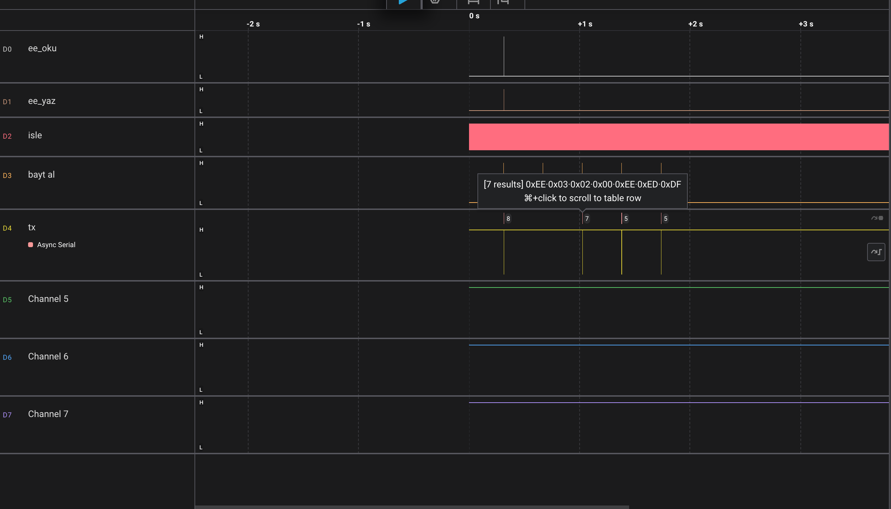

# 04/02 – µs Zamanlama ve EEPROM'da Saklanan Slave Adresi

04/01'deki Modbus RTU slave'ine iki yetenek eklendi:

1. **µs hassasiyetinde zamanlama.** Paket sınırları 1 ms'lik tick yerine µs ile ölçülüyor. t1.5 ve t3.5 süreleri koda sabit yazılmıyor, **baud'dan hesaplanıyor**. Aynı kod 1200, 9600 ve 115200'de standarda uygun çalışıyor.
2. **Değiştirilebilir ve kalıcı slave adresi.** Adres register 5'ten okunup yazılabiliyor ve **EEPROM**'da saklanıyor. Reset ya da elektrik kesintisinden sonra da korunuyor.

UART, Modbus ve EEPROM, birbirini tanımayan üç ayrı modül. Hepsini main.c birbirine bağlıyor. Bütün zamanlama, debug pinleri ve lojik analizörle ölçülerek doğrulandı.

[01-basic-modbus](../01-basic-modbus)'un üzerine kuruludur.

---

## İçindekiler
1. [Register tablosu](#1-register-tablosu)
2. [115200 baud](#2-115200-baud)
3. [µs hassasiyetinde zamanlama](#3-µs-hassasiyetinde-zamanlama)
4. [EEPROM'da slave adresi](#4-eepromda-slave-adresi)
5. [Mimari](#5-mimari)
6. [Ölçüm yöntemi: debug pinleri](#6-ölçüm-yöntemi-debug-pinleri)
7. [Ölçümler](#7-ölçümler)
8. [Testler](#8-testler)
9. [Öğrenilenler](#9-öğrenilenler)
10. [Bilinen sınırlamalar](#10-bilinen-sınırlamalar)
11. [Sonraki adımlar](#sonraki-adımlar)

---

## 1. Register tablosu

**Varsayılan slave adresi:** `0xEF` (239), 115200 8N1

| Register | İçerik | Okuma | Yazma |
|---|---|---|---|
| 0 | Cihaz kimliği (sabit `0xEFE1`) | ✓ | ✗ → 02 |
| 1 | LED (PB5), 0 / 1 | ✓ | ✓, diğer değerler → 03 |
| 2 | Uptime, üst 16 bit (ms) | ✓ | ✗ → 02 |
| 3 | Uptime, alt 16 bit (ms) | ✓ | ✗ → 02 |
| 4 | Sıcaklık, °C × 10 (şimdilik sabit 235) | ✓ | ✗ → 02 |
| **5** | **Slave adresi** | ✓ | ✓, 1–247 dışı → 03. **EEPROM'a kaydedilir** |

---

## 2. 115200 baud

UART baud'u, 16 MHz'lik saatin bir bölücüyle (UBRR) bölünmesiyle elde ediliyor:

```
normal:  UBRR = F_CPU / (16 · baud) − 1
U2X:     UBRR = F_CPU / (8  · baud) − 1
```

UBRR bir tam sayı olmak zorunda. 115200 için normal modda sonuç 7,68 çıkıyor ve **8**'e yuvarlanıyor. Bu da gerçekte ~111 111 baud demek, yani −%3,5 hata. Bu hata alıcının tolere edebileceği sınıra çok yakın. **U2X** (çift hız) modunda bölücü 8 olduğu için UBRR **16** çıkıyor ve hata +%2,1'e iniyor.

| | Normal (÷16) | U2X (÷8) |
|---|---|---|
| UBRR | 8 (7,68 → yuvarlandı) | 16 |
| Gerçek baud | 111 111 | 117 647 |
| Hata | −%3,5 | +%2,1 |

Yuvarlama makroda yapılıyor: bölmeden önce bölenin yarısı ekleniyor. Makro parametreleri parantez içinde, çünkü önişlemci sadece metin yapıştırıyor (bkz. [Öğrenilenler](#9-öğrenilenler)).

```c
#define UBRR_NORMAL(baud)  (((F_CPU + 8UL * (baud)) / (16UL * (baud))) - 1)
#define UBRR_U2X(baud)     (((F_CPU + 4UL * (baud)) / ( 8UL * (baud))) - 1)
```

**Ölçülen:** Analizörde baytlar arası süre **85,25 µs** çıktı (10 bit). Bu ~117 300 baud demek, hesaplanan değerle uyumlu.

---

## 3. µs hassasiyetinde zamanlama

Modbus RTU'da paketin başını ya da sonunu gösteren özel bir bayt yok. Paketin sonunu **sessizlik** belirliyor: hat **3,5 karakter** süresi boyunca boş kalırsa paket bitmiş sayılıyor.

| | Ne ölçer? | Aşılırsa |
|---|---|---|
| **t1.5** | Paketin içindeki iki bayt arası en uzun sessizlik | Paket bozuk sayılır, t3.5'ten sonra atılır |
| **t3.5** | Paketin bittiğini gösteren sessizlik | Paket kapanır, uzunluk / adres / CRC kontrolüne gider |

### Baud'a göre süreler

Modbus bir karakteri **11 bit** sayar: start + 8 veri + parite + stop. Parite kullanılmazsa yerine ikinci bir stop biti gelir. Hatta giden gerçek bayt 8N1'de 10 bit olsa da, hesapta 11 bit kullanmak süreleri biraz uzatır, yani güvenli taraftadır.

```
karakter = 11 · 1 000 000 / baud    (µs)

baud ≤ 19200:   t1.5 = 1,5 · karakter      t3.5 = 3,5 · karakter
baud > 19200:   t1.5 = 750 µs (sabit)      t3.5 = 1750 µs (sabit)
```

**19200'ün üstünde neden sabit?** Baud yükseldikçe 3,5 karakter çok kısalıyor. 115200'de sadece ~334 µs kalıyor. Bu kadar kısa bir sessizliği güvenilir şekilde ölçmek işlemciye yük bindirir. Master'ın (özellikle PC + USB dönüştürücü) baytlar arasına bıraktığı küçük boşluklar da yanlışlıkla "paket bitti" diye algılanabilir. Standart bu yüzden yüksek hızlarda sabit bir alt sınır koyuyor.

| Baud | 1 karakter | t1.5 | t3.5 |
|---|---|---|---|
| 1200 | 9 166 µs | 13 750 µs | 32 083 µs |
| 9600 | 1 146 µs | ~1 717 µs | ~4 010 µs |
| 115200 | — | 750 µs (sabit) | 1 750 µs (sabit) |

Hesap tam sayılarla yapılıyor. Çarpma taşmasın diye `UL` ekleniyor, 3,5 için de `× 35 / 10` yazılıyor (önce çarp, sonra böl). Değerler `uint32_t`: 300 baud'da t3.5 ≈ 128 ms ediyor ve bu `uint16_t`'ye sığmaz.

### Boşluk bölgeleri

```
0 ─────────── t1.5 ─────────────────── t3.5 ──────────→  baytlar arası boşluk
  normal paket  │   bozuk paket:           │  paket bitti:
  devam ediyor  │   bayrak kalkar, paket   │  uzunluk / adres / CRC
                │   t3.5'i bekleyip atılır │  kontrolüne gider
```

Ortadaki bölgede paket hemen atılmıyor. Önce bayrak kaldırılıyor, t3.5 bekleniyor, sonra atılıyor. Paket hemen atılsaydı paketin geri kalan baytları **yeni bir paketin ilk baytı** sanılırdı.

t1.5 kontrolü iki şarta bağlı:
```c
else if ((bayt_sayaci != 0) && (simdi - son_byte_us > t15_us + bayt_suresi_us))
```
- `bayt_sayaci != 0`: sadece paketin **içindeyken** kontrol et. İlk bayttan önceki sessizlik t3.5'tir, hata değil.
- `+ bayt_suresi_us`: zaman damgası bayt **tamamen geldiğinde** alınıyor. İki damga arasındaki fark, sessizliğe ek olarak bir baytın kendi süresini de içeriyor.

---

## 4. EEPROM'da slave adresi

### EEPROM modülü

ATmega328P'de 1 KB EEPROM var (adres 0–1023). Üç register'la kullanılıyor:

| Register | Görevi |
|---|---|
| `EEAR` (H/L) | Adres: hangi bayt. 10 bit, iki register'a bölünmüş |
| `EEDR` | Veri: yazılacak ya da okunan bayt |
| `EECR` | Kontrol: `EERE` (oku), `EEMPE` (yazmaya izin), `EEPE` (yaz + meşgul bayrağı) |

```c
uint8_t eeprom_oku(uint16_t adres);
void    eeprom_yaz(uint16_t adres, uint8_t veri);
void    eeprom_guncelle(uint16_t adres, uint8_t veri);   // sadece değer farklıysa yaz
```

**Okuma** neredeyse anında: adres ayarlanır, `EERE` = 1 yapılır, CPU 4 çevrim durur, veri `EEDR`'de hazır olur.

**Yazma** iki anahtarlı bir kilitle korunuyor: önce `EEMPE` (anahtar), sonra **en fazla 4 çevrim içinde** `EEPE` (düğme). Donanım `EEMPE`'yi 4 çevrim sonra kendiliğinden kapatır. Bu sayede program bir hata yüzünden rastgele register'lara yazsa bile EEPROM bozulmaz. İki satırın arasına bir kesme girerse (bir ISR ~72 çevrim sürüyor) pencere kapanır ve yazma **sessizce olmaz**. Bu yüzden sadece bu iki satır kesmeler kapalıyken çalışıyor:

```c
uint8_t sreg = SREG;
cli();
EECR |= (1 << EEMPE);
EECR |= (1 << EEPE);
SREG = sreg;
```

Okumada `cli` gerekmiyor: süreli bir pencere yok ve hiçbir ISR EEPROM'a dokunmuyor.

**Yazma 3,4 ms sürüyor, ama fonksiyon beklemiyor.** Yazmayı başlatıp hemen dönüyor, donanım arkada yazıyor. Bu sürede `EEPE` 1'de kalıyor (meşgul bayrağı). Bekleme, her fonksiyonun **başında** yapılıyor:
```c
while (EECR & (1 << EEPE));
```
"Sonunda bekleme, başında bekle": EEPROM'a 3,4 ms içinde tekrar dokunulmazsa main hiç beklemiyor. Beklese bile kesmeler çalışmaya devam ettiği için gelen UART baytları kaybolmuyor.

### Adresin yaşam döngüsü

```c
#define EE_SLAVE_ADRES  1000     // EEPROM haritası: slave adresi 1000. baytta
```

**Açılış:**
```c
Modbus.init(BAUD, eeprom_oku(EE_SLAVE_ADRES));
uint8_t son_kayit = Modbus.adres();
```
`init` gelen değeri doğruluyor: **1–247** dışındaysa varsayılan `0xEF`'i kullanıyor. Bu sayede main'de ayrı bir kontrol gerekmiyor:
- EEPROM ilk kez kullanılıyor → içi `0xFF` → geçersiz → `0xEF`
- Yazma sırasında elektrik kesilip bayt bozulduysa → büyük ihtimalle geçersiz → `0xEF`
- Daha önce `0xEE` kaydedildiyse → geçerli → `0xEE`

**Değiştirme:** Master `EF 06 00 05 00 EE` gönderiyor. Cevap **eski adresten** (`EF`) gidiyor, çünkü master cevabı orada bekliyor. 06'nın cevabı isteğin birebir kopyası olduğu için bu kendiliğinden oluyor. Yeni adres bir sonraki paketten itibaren geçerli. Hata cevapları ve 03 cevabı da ilk bayta sabit bir değer değil, `slave_adres` değişkenini yazıyor.

**Kaydetme (polling):** modbus.c EEPROM'u bilmiyor. Adresin değiştiğini main fark ediyor:
```c
if (son_kayit != Modbus.adres()) {
    eeprom_guncelle(EE_SLAVE_ADRES, Modbus.adres());
    son_kayit = Modbus.adres();
}
```
EEPROM sadece adres **değiştiği an** bir kez yazılıyor. EEPROM ~100 000 yazmaya dayanıyor: her istekte yazılsaydı ve master 100 ms'de bir sorsaydı, ömrü ~3 saat olurdu. `eeprom_guncelle` ikinci bir güvenlik katmanı: değer zaten aynıysa yazmıyor.

Asıl değer `slave_adres` değişkeni, `registerlar[5]` ise ondan doldurulan bir kopya (LED register'ının pin durumunu yansıtması gibi).

---

## 5. Mimari

```
uart.c    ── donanım: UBRR, register'lar, RX/TX kesmeleri, halka tamponlar
eeprom.c  ── donanım: EEPROM register'ları, okuma/yazma sırası
modbus.c  ── protokol: zamanlama, çerçeve, CRC, register tablosu
main.c    ── üçünü birbirine bağlar, aralarında sayıları (bayt, zaman, baud, adres) taşır
```

| Dosya | Ne biliyor? | Ne bilmiyor? |
|---|---|---|
| `uart.c` | Register'lar, UBRR, kesmeler, halka tamponlar | Modbus'ı |
| `eeprom.c` | EEPROM register'ları | Neyin saklandığını |
| `modbus.c` | Baud, zaman ve adres (sayı olarak), çerçeve, CRC, register tablosu | UART'ı, timer'ı, EEPROM'u |
| `main.c` | Modüllerin kapılarını | Modüllerin içini |

### Struct ile tek kapı

Her modül dışarıya tek bir `const` struct nesnesi açıyor. `.h`'da struct'ın tipi ve `extern` bildirimi var, nesnenin kendisi ve fonksiyonlar `.c`'de. Fonksiyonlar `static`, yani başka dosyalardan isimleriyle çağrılamıyor. Dışarıya sadece adresleri, struct'ın içinden açılıyor.

```c
// main.c
#define BAUD            115200
#define EE_SLAVE_ADRES  1000

Usart.init(BAUD);
Modbus.init(BAUD, eeprom_oku(EE_SLAVE_ADRES));
uint8_t son_kayit = Modbus.adres();
sei();

while (1) {
    uint32_t simdi = getTickinMicro();

    if (son_kayit != Modbus.adres()) {
        eeprom_guncelle(EE_SLAVE_ADRES, Modbus.adres());
        son_kayit = Modbus.adres();
    }

    while (Usart.ring_buffer_not_empty())
        Modbus.bayt_al(Usart.ring_buffer_read_byte(), simdi);

    uint8_t n = Modbus.isle(simdi, cevap, getTickTime());
    if (n) Usart.send_data(cevap, n);
}
```

Dosya içinde paylaşılan durum (`tampon`, `bayt_sayaci`, `son_byte_us`, `t15_us`, `t35_us`, `slave_adres`) **dosya `static`**'i. Sadece tek fonksiyonda kullanılan değerler **yerel**. `son_kayit` main'de döngüden önce tanımlandığı için program boyunca yaşıyor.

> [!TIP]
> `modbus.c`, ne `uart.h`'ı ne `eeprom.h`'ı include ediyor. Baud'u, zamanı ve adresi **sayı** olarak alıyor. Bu yüzden bilgisayarda gcc ile test edilebiliyor. STM32'ye geçince `uart.c` ve `eeprom.c` tamamen değişecek, `modbus.c`'ye dokunulmayacak.

---

## 6. Ölçüm yöntemi: debug pinleri

**Debug palsi**, kodun belli bir satırına koyulan kısa bir H → L geçişi. Analizörde ince bir çizgi olarak görünüyor ve "kod tam şu an bu satırdan geçti" anlamına geliyor.

Başta istekleri RX hattından izlemek istedim, ama RX analizörde görünmedi. Debug pinleri daha iyi bir şey de sağladı: hatta **ne geçtiğini** değil, **MCU'nun ne karar verdiğini** ve **kesmelerin ne zaman çalıştığını** gösteriyorlar.

| Kanal | Ne zaman pals? |
|---|---|
| READ BYTE | `modbus_bayt_al` her bayt aldığında |
| ISLE | `modbus_isle`'ye her girişte (ana döngünün nabzı) |
| SEND MESSAGE | Adres ve CRC kontrolü geçildi, switch'e giriliyor |
| ISR_TIMER | Timer0 karşılaştırma kesmesi (1 ms) |
| t1.5 | t1.5 aşıldı, paket bozuk sayıldı |
| ee_oku / ee_yaz | EEPROM okuma ve yazma |

Bir pals ~125 ns sürüyor. Analizörün örnekleme hızı düşükse palsi kaçırabiliyor: ilk denemede 8 bayttan 7'si görünmüştü.

---

## 7. Ölçümler

### Son bayttan cevaba

```
son bayt ──(A)── SEND MESSAGE ──(B)── ilk TX biti
```

| İstek | A | B |
|---|---|---|
| `06` LED yaz | 1,79 ms | ~15 µs |
| `03` 1 register | 1,79 ms | ~56 µs |
| `03` 5 register | 1,79 ms | ~100 µs |

**A sabit.** İçinde t3.5 sessizliği (1750 µs) ve isteğin CRC kontrolü var. Bütün istekler 8 bayt, CRC her seferinde 6 bayt üzerinden hesaplanıyor. Bu yüzden süre hep aynı. İsteğin içeriğine ilk kez switch'te bakılıyor, o da A'dan sonra geliyor.

**B değişiyor.** İçinde cevabın hazırlanması ve cevabın CRC'si var. Okunan register sayısı arttıkça cevap uzuyor, CRC de daha fazla bayt üzerinden hesaplanıyor. `06`'nın cevabı isteğin birebir kopyası olduğu için en hızlısı o.

Gecikmenin neredeyse tamamı Modbus'ın zorunlu tuttuğu t3.5 sessizliğinden geliyor. Kod en kötü durumda ~100 µs harcıyor, yani toplamın ~%5'i. Burada CRC'yi hızlandırmanın (tablo yöntemi) anlamı yok. **Önce ölç, sonra optimize et.**

### Ana döngü ve kesmeler

| Ölçüm | Değer |
|---|---|
| Ana döngü turu (boşta) | ~9–10 µs |
| Ana döngü turu (bayt işlenirken) | ~16,4 µs |
| Timer0 ISR aralığı | 1,000 ms |
| ISR süresi | ~4,5 µs |
| UDRE kesmesinin döngüye etkisi | tur ~10 → ~13 µs (her baytın başında) |

Bir kesme main'i **herhangi bir yerde**, iki satırın arasında bile durdurabiliyor. Kesme debug palsinin H ve L satırları arasına denk gelince pin ISR bitene kadar yüksekte kalıyor, pals ~125 ns yerine ~4,5 µs sürüyor. Uzun pals aslında ISR'ın süresini ölçüyor.

Cevap gönderilirken ana döngü durmuyor. `send_data` baytları halka tampona koyup hemen dönüyor, baytları hatta UDRE kesmesi tek tek gönderiyor. Bu kesme her baytın başında bir kez çalışıyor ve o turu birkaç µs uzatıyor.

---

## 8. Testler

### t1.5 testi

Testte paket ikiye bölünüyor: önce 3 bayt, araya bir boşluk, sonra kalan 5 bayt ([`t15_test.py`](t15_test.py)).

**`write()` ve `flush()`:** Python'da `s.write()` baytları hatta göndermiyor. Onları bilgisayarın gönderme tamponuna koyup hemen geri dönüyor, baytları USB çipi arkadan gönderiyor. `flush()` olmadan, 9600'de 3 baytın gönderilmesi 3,1 ms sürdüğü için 2,5 ms'lik `sleep` hatta hiç boşluk oluşturmadı. `s.flush()` "tampondaki her şey hatta gidene kadar bekle" demek.

**Neden 1200 baud?** Mac + USB dönüştürücü, `flush()` ile bile **~2,5 ms'den kısa** bir boşluk oluşturamıyor. 115200'de (t1.5 = 750 µs) ve 9600'de (t1.5 ≈ 1,7 ms) sınırın altına inilemiyor. 1200 baud'da bütün süreler büyüdüğü için sınırın iki tarafı da test edilebiliyor.

| Boşluk (`sleep`) | Bölge | t1.5 pini | Cevap |
|---|---|---|---|
| 3 ms | < t1.5 | — | ✅ geldi |
| 10 ms | < t1.5 | — | ✅ geldi |
| 20 ms | t1.5 – t3.5 | pals | ❌ yok |
| 50 ms | > t3.5 | — | ❌ yok |

Son iki durumda dışarıdan bakınca ikisinde de cevap yok. İkisini birbirinden **sadece t1.5 debug pini** ayırıyor.

10 ms'lik test önemli: "boşluk + bir bayt" düzeltmesinden önce bu paket reddediliyordu, oysa standarda göre geçerli (bkz. [Öğrenilenler](#9-öğrenilenler)).

**t3.5'i geçen paket:** Bu durum için ayrı bir kural yok. t3.5 dolunca `isle` paketi kapatıyor ve her pakete uyguladığı kontrolleri sırayla uyguluyor: bayrak → uzunluk ≥ 4 → adres → CRC.

| Parça | Baytlar | Takıldığı kontrol |
|---|---|---|
| 1. | `EF 06 00` | Uzunluk 3 < 4 |
| 2. | `01 00 01 0E 84` | Adres 0x01 ≠ 0xEF |

Adres tesadüfen tutsaydı bile CRC yakalardı. Kontroller katman katman çalışıyor: biri kaçırırsa bir sonraki yakalıyor.

### EEPROM testi

[`eeprom_test.py`](eeprom_test.py) iki aşamada çalışıyor. Python portu kapatıp yeniden açtığında USB çipinin DTR hattı Arduino'yu **kendiliğinden resetliyor**. Test bunu kullanıyor: reset için elle bir şey yapmak gerekmiyor.

| # | Aşama | Test | Beklenen |
|---|---|---|---|
| 1 | 1 | `EF`: adresi `0xEE` yap | Eko, **eski** adresten (`EF`) |
| 2 | 1 | `EF`: eski adres | Cevap yok |
| 3 | 1 | `EE`: register 5'i oku | `EE 03 02 00 EE` |
| 4 | 1 | `EE`: adrese 0 yaz | `EE 86 03` (geçersiz değer) |
| 5 | 1 | `EE`: adrese 248 yaz | `EE 86 03` |
| — | | *port kapandı → yeniden açıldı → **reset*** | |
| 6 | 2 | `EE`: reset sonrası oku | `EE 03 02 00 EE` ← **kalıcılık** |
| 7 | 2 | `EE`: adresi `0xEF`'e geri al | Eko, `EE`'den |
| 8 | 2 | `EF`: geri alındı mı? | `EF 03 02 00 EF` |



4. ve 5. testlerde hata cevabının ilk baytının `EE` olması önemli: hata cevabı da adresi sabit bir değerden değil, `slave_adres` değişkeninden alıyor.

---

## 9. Öğrenilenler

### Zamanlama

**İlk baytta t1.5 alarmı.**
115200'e geçince slave hiçbir pakete cevap vermedi. t1.5 kontrolü paketin **ilk baytında** da çalışıyordu. O anda `son_byte_us` bir önceki paketin son baytını gösteriyordu, aradaki fark hep 750 µs'den büyük çıkıyordu.
→ Kontrol sadece paketin içindeyken yapılmalı: `bayt_sayaci != 0`.

**"Boşluk" değil, "boşluk + bir bayt" ölçülüyordu.**
1200 baud'da bir bayt 8,3 ms sürüyor. 10 ms'lik boşluklu paket, standarda göre geçerli olduğu hâlde 18,3 ms ölçülüp reddediliyordu.
→ Eşiğe bir bayt süresi eklendi.

**İşaretsiz sayıda çıkarma taşması.**
Düzeltmenin ilk hâli `(simdi - son_byte_us) - bayt_suresi > t15` idi. Fark bayt süresinden küçük kalınca sonuç negatif olacaktı, ama `uint32_t`'de negatif yok: sonuç ~4,29 milyar oldu ve her bayt alarm verdi.
→ İşaretsiz sayılarda çıkarmayı karşı tarafa toplama olarak taşı.

**Tüm kanallar aynı anda yükseldi: reset.**
Python portu açtığında analizörde bütün pinler ~1,5 s yüksekte kaldı. Port açılınca DTR hattı Arduino'yu resetliyor, reset pinleri girişe çeviriyor, bootloader bekliyor.
→ Bütün kanallar aynı anda tuhaflaşıyorsa koda değil, sisteme bak: reset, besleme, GND.

### EEPROM ve adres

**Unutulan struct alanı → sonsuz yeniden başlama.**
`Modbus_t`'ye `adres` alanı eklendi, ama `const Modbus_t Modbus = {...}` tanımına `.adres = ...` satırı yazılmadı. C'de ilk değer verilmeyen alan **0** olur. main her turda `Modbus.adres()` çağırınca **0 adresine**, yani reset vektörüne zıpladı: program her turda baştan başladı, hiçbir pakete cevap veremedi.

Analizör yanıltıcıydı. Bu gerçek bir reset değil, sadece kodun başına bir zıplama:

| Gözlem | Neden |
|---|---|
| Bootloader'ın ~1,5 s'lik izi yok | Bootloader sadece donanım resetinde çalışır |
| Timer palsleri kesintisiz | Zıplama timer donanımını sıfırlamıyor, her yeniden başlama µs'ler sürüyor |
| Çağrıdan önceki pin hep H | Zıplama `PORTB`'yi sıfırlamıyor, L satırına hiç ulaşılmıyor |
| Bayt alınmıyor | Her başlangıçta .bss sıfırlanıyor, halka tamponun indeksleri de |

→ `-Wextra` bu hatayı *missing initializer* uyarısıyla derleme anında yakalar:
```ini
build_flags = -Wall -Wextra
```
→ main'in **en başına** bir "açılış" palsi koy. Tekrar tekrar görünüyorsa program başa dönüyor demektir.

**Debug pini `if`'in içinde kaldı.**
L satırı `if` bloğunun içine konunca, koşul yanlışken (normal durum) hiç çalışmadı. Program takılmış gibi göründü, oysa devam ediyordu.
→ Ölçüm pininin H ve L'si her yoldan geçilecek yerlerde olmalı.

**`EECR | (1 << EEPE);`**
`|=` yerine `|` yazılmıştı. Satır bir değer hesaplıyor ama hiçbir yere yazmıyordu. Anahtar çevriliyor ama düğmeye basılmıyordu, EEPROM'a **hiç yazılmıyordu**.
→ `-Wall` bunu *statement with no effect* diye yakalar.

**Okumada sıra.**
`EERE`, `EEAR` ayarlanmadan önce yazılmıştı. Okuma o anda başladığı için bir önceki adresin değeri okunuyordu.
→ Önce adres, sonra `EERE`, sonra `EEDR`.

**`||` ile `&&`.**
LED değerinin kontrolü `if ((d != 0) || (d != 1))` diye yazılmıştı. Her değer ya 0'dan ya 1'den farklı olduğu için koşul **hep doğruydu** ve LED'e hiçbir değer yazılamıyordu.
→ "0 da değil, 1 de değil" = `!(d == 0 || d == 1)`.

### Genel

**U2X makrosunda yuvarlama:** bölenin yarısı `4·baud` yerine `8·baud` yazılmıştı, UBRR 16 yerine 17 çıkıyordu.

**Yanlış fonksiyon pointer'ı:** `Usart` struct'ında string gönderme alanına `rb_oku` bağlanmıştı. Derleyici *incompatible pointer type* uyarısı verdi. Fonksiyon pointer'larında bu uyarı hemen her zaman gerçek bir hatadır.

**Makro parametresi parantezsiz:** `UBRR(9600 + 9600)` gibi bir çağrı `8UL * 9600 + 9600` diye açılır ve sessizce yanlış bir baud verirdi.

<details>
<summary>Diğer notlar</summary>

- **Port adı değişti:** Kart farklı bir USB portuna takılınca `wchusbserial130` → `wchusbserial1130` oldu. Çalıştırmadan önce `ls /dev/cu.*` ile kontrol et.
- **Aynı porta iki program:** *"device reports readiness to read but returned no data"* hatası, portu başka bir programın da (seri monitör, `screen`) açık tuttuğu anlamına geliyordu. `lsof | grep wchusbserial` ile bulundu.
- **Bayt sırası (LSB önce):** Analizörde 0x27'nin bitleri `1110 0100` diye görünüyor. UART en düşük biti önce gönderiyor, zaman da soldan sağa akıyor.
- **Bootloader ile yükleme EEPROM'u silmiyor:** Yeni kod yüklendikten sonra da kayıtlı adres duruyor.

</details>

---

## 10. Bilinen sınırlamalar

| Bu sürüm | Gerçek bir ürün |
|---|---|
| TTL UART, tek slave | RS-485, aynı hatta 32+ cihaz, DE/RE yön kontrolü |
| 8N1 sabit | Parite (8E1, standardın varsayılanı) ve 2 stop biti seçilebilir |
| Fonksiyon 03 ve 06 | Genelde 03, 04, 06, 16 |
| 8 baytlık tampon: fonksiyon 16 sessizce atılıyor | Tam tampon (256 bayt), desteklenmeyen fonksiyona 01 hatası |
| Broadcast (adres 0) yok sayılıyor | 06 uygulanır, cevap verilmez |
| Baud derleme zamanında `#define` ile seçiliyor | Baud da register'dan ayarlanır, EEPROM'da saklanır |
| µs zamanlayıcı (4 µs çözünürlük), ama damga main döngüsünde alınıyor: ~10–16 µs gecikme | Damga RX kesmesinde alınır |
| t1.5 sınırı 1200 baud'da Mac ile test edildi | 115200'deki tam sınır µs hassasiyetli bir master ile ölçülür (Uno ile yapılacak) |
| 115200'de baud hatası +%2,1 | Baud'a uygun kristal (örn. 14,7456 MHz) ile %0 hata |

---

## Sonraki adımlar

- [x] `01-basic-modbus`: 03/06, exception'lar, pymodbus ile test
- [x] `02-eeprom-microus-modbus`
  - [x] µs zamanlama, baud'dan hesaplanan t1.5 / t3.5
  - [x] 1200 / 9600 / 115200 testleri
  - [x] Slave adresi register'dan değiştirilebilir ve EEPROM'da saklanır
- [ ] `03-rs485-modbus`: MAX485, DE/RE yön kontrolü, fonksiyon 04 ve 16, büyük tampon
- [ ] UART: parite ve 2 stop biti, zaman damgasını RX kesmesinde almak
