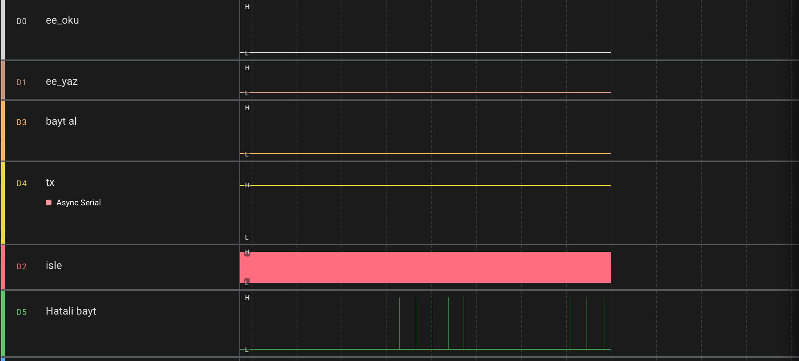
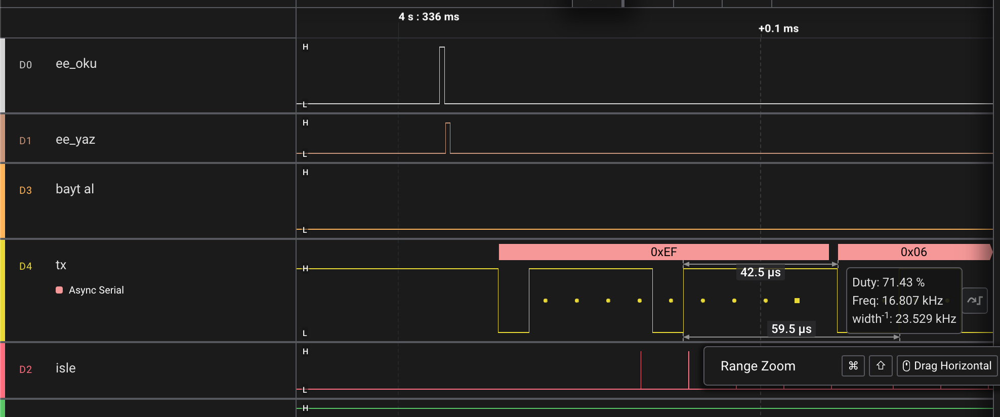
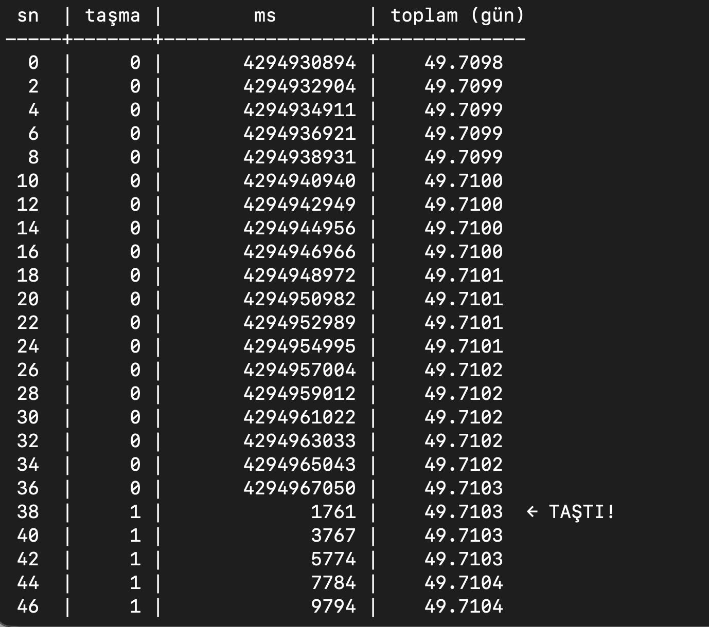

# 04/04 — Callback'ler, Parite Modları ve Taşmaya Dayanıklı Zaman

> ATmega328P (Arduino Uno) üzerinde bare-metal Modbus RTU slave — 4. aşama.
> Modüller arası bağımlılığı **callback**'lerle kaldırma, UART'ı **6 karakter formatına** açma,
> RX'te **donanım hata bitlerini** kullanma ve zaman ölçümünü **taşmaya dayanıklı** hale getirme.

---

## Bu aşamada ne değişti?

| Konu | 04/03 | 04/04 |
|---|---|---|
| Adres değişince EEPROM'a kayıt | main her turda `son_kayit != adres` diye **soruyordu** (polling) | modbus **haber veriyor** (`adres_cb`) |
| RX bayt zamanı | ISR içinde, timer'a doğrudan bağlı | **zaman kaynağı callback'i** (`zaman_al`) → uart.c timer'ı bilmiyor |
| UART formatı | sadece 8N1 | **8N1, 8E1, 8O1, 8N2, 8E2, 8O2** |
| RX hatalı bayt | kontrol yok | **UPE / FE / DOR** bitleri → bayt atılır |
| Karakter süresi | 10 bit | **11 bit** (Modbus karakteri) |
| Zaman damgası | `uint32_t` (512 B) | **`uint16_t`** (256 B) + taşmaya dayanıklı fark |
| Uptime | 32 bit ms → **49,7 günde sıfırlanır** | 48 bit (taşma sayacı + ms) → ~8900 yıl |

---

## Register haritası

| Reg | İçerik | Erişim |
|---|---|---|
| 0 | Kimlik `0xEFE1` | R |
| 1 | LED (0/1) | R/W |
| 2 | **Uptime taşma sayacı** (her 49,7 günde +1) | R |
| 3 | Uptime ms — üst 16 bit | R |
| 4 | Uptime ms — alt 16 bit | R |
| 5 | Slave adresi (1–247, EEPROM'da kalıcı) | R/W |

Uptime, **reg 2'den 3 adet** tek istekte okunmalı (Modbus'ta çok register'lı değerler büyük anlamlıdan küçüğe):

```
toplam_ms = reg2 · 2³² + reg3 · 2¹⁶ + reg4
```

---

## 1. Callback'ler: modüller birbirini tanımıyor

```
            ┌──────────── main.c (bağlantıyı kuran) ────────────┐
            │                                                   │
  Usart.init(…, getTickinMicro)              Modbus.modbus_init(…, guncellik_callback)
            │                                                   │
            ▼                                                   ▼
  uart.c: zaman_al ──icall──► timer.c        modbus.c: adres_cb ──icall──► eeprom.c
  (timer'ı #include etmiyor)                 (eeprom'u #include etmiyor)
```

| | `zaman_al` | `adres_cb` |
|---|---|---|
| Tip | `uint32_t (*)(void)` | `void (*)(uint8_t)` |
| Ne zaman | her RX baytında, **ISR içinde** | register 5'e yazılınca, main döngüsünde |
| Ne yapıyor | şu anki µs | yeni adresi EEPROM'a kaydeder (`eeprom_guncelle`) |
| NULL koruması | `zaman_al ? zaman_al() : 0` | `if (adres_cb) adres_cb(…)` |

### Callback'in bedeli — makine kodunda ölçüldü
`avr-objdump` ile RX ISR'i incelendi:

| ISR | Boyut | Not |
|---|---|---|
| `__vector_18` (RX) | **168 B** | `icall` var → 16 `push` + 16 `pop` |
| `__vector_19` (UDRE) | 92 B | callback yok |

Derleyici `icall`'ın arkasındaki fonksiyonu göremediği için çağrıda bozulabilecek tüm
register'ları (r18–r27, r30–r31) yedekliyor: **~64 çevrim ≈ 4 µs** sadece yedekleme.
Esneklik kazanıldı, karşılığında ISR süresi uzadı. Callback'ler bu yüzden **kısa** tutuluyor.

---

## 2. UART karakter formatları ve RX hata kontrolü

```c
uint8_t c = (1<<UCSZ01) | (1<<UCSZ00);       // 8 veri biti
case DATA_EVEN_PARITY_1STOP: UCSR0C = c | (1<<UPM01);              break;
case DATA_ODD_PARITY_1STOP:  UCSR0C = c | (1<<UPM01) | (1<<UPM00); break;
case DATA_NO_PARITY_2STOP:   UCSR0C = c | (1<<USBS0);              break;
...
```

RX ISR'de sıra önemli: **önce durum, sonra veri** — `UDR0` her durumda okunur (RXC bayrağı ancak böyle temizlenir):

```c
uint8_t durum  = UCSR0A;
uint8_t okunan = UDR0;
if (!(durum & ((1<<UPE0) | (1<<FE0) | (1<<DOR0)))) { … ring buffer'a yaz … }
```

Hatalı bayt atılınca paket kısalır → CRC tutmaz → paket sessizce reddedilir.

> **Not:** `USBS0` (2 stop) sadece **gönderimi** etkiler; alıcı her zaman ilk stop bitine bakar.
> 8N1 ↔ 8N2 bu yüzden birbirini anlar.

---

## 3. 16 bitlik zaman damgası

En uzun ölçülen fark t3.5'tir (1200 baud'da 32 ms). `uint16_t` µs sayacı **65,5 ms**'de bir sarar →
iki kat pay var. Üst 16 bit fark hesabına katkı vermediği için atıldı:

```c
rb_zaman[rb_bas] = (uint16_t)zaman_al();                       // ISR
if ((uint16_t)(simdi - son_byte_us) > t15_us + byte_gidisi_us) // fark — CAST'li
```

İşaretsiz çıkarma sarmayı kendiliğinden düzeltir: `(uint16_t)(10 − 65530) = 16 µs`.

**Cast neden şart?** C, `int`'ten küçük tipleri işlemden önce `int`'e yükseltir (integer promotion).
AVR'de `int` 16 bit olduğu için `uint16_t` yükseltilmez; **STM32'de `int` 32 bit** → fark `−65520` çıkar.
Cast, sonucu tekrar 16 bite sıkıştırır; kod iki mimaride de doğru çalışır.

**Kazanç:** `rb_zaman[128]` 512 B → 256 B.

---

## 4. Uptime taşması (49,7 gün)

```c
ISR(TIMER0_COMPA_vect) {
    if (++compare_match_counter == 0) tasma_sayaci++;
}

void getTick_Overflow(uint32_t *ms, uint16_t *tasma) {   // ikisi AYNI ANDA
    uint8_t sreg = SREG; cli();
    *ms = compare_match_counter;  *tasma = tasma_sayaci;
    SREG = sreg;
}
```

Ayrı ayrı okunsaydı, iki okuma arasında taşma olursa **eski ms + yeni taşma** → 49,7 gün hata.
Kritik bölge, değişkenin **ISR tarafından yazıldığı modülde** — kopyası alındıktan sonra korumanın anlamı yok.

---

## Testler

### EEPROM kalıcılığı (8E1 ↔ 8E1) — `eeprom_test.py`
```
8/8 geçti
```

### Parite uyumsuzluğu
| Arduino | Python | Sonuç | Neden |
|---|---|---|---|
| 8E1 | 8E1 | **8/8** | |
| 8E1 | 8O1 | **1/8** (sadece "susmalı" testi) | her baytın paritesi ters → UPE → atıldı |
| 8E1 | 8N1 | **cevap yok** | Python'un stop biti parite yerine okunuyor → baytların ~yarısı UPE |

Reddedilen baytlar `modbus_bayt_al`'a hiç ulaşmıyor (D3 "bayt al" pininde darbe yok).



*0xEF = 7 tane '1' → çift parite biti 1.*


### Uptime taşması — `uptime_test.py`

Sayaç geçici olarak `0xFFFF63C0` ile başlatıldı (taşmaya ~40 sn):


```
 sn  | taşma |        ms        | toplam (gün)
 34  |     0 |       4294965043 |    49.7102
 36  |     0 |       4294967050 |    49.7103
 38  |     1 |             1761 |    49.7103  ← TAŞTI!
 40  |     1 |             3767 |    49.7103
```

`4 294 967 050 + ~2007 − 2³² = 1761` → taşma anında **tek ms kaybı yok**, toplam süre geri gitmiyor.
Aynı test sırasında µs sayacı da taşma noktasından geçti; **25 isteğin 25'i cevaplandı** →
t1.5/t3.5 hesapları sarmaya dayanıklı.

---

## Hata hikâyeleri

**1. Zaman damgası yanlış kutuda.** `rb_bas` ilerletildikten **sonra** `rb_zaman[rb_bas]` yazılıyordu →
her bayt bir öncekinin zamanını taşıyordu → paketin 2. baytında fark "açılıştan beri geçen süre" çıkıyor
→ her paket t1.5 ihlali → **hiç cevap yok**. Kural: veriyi ve zamanı **aynı kutuya** yaz, `rb_bas`'ı **en son** ilerlet.

**2. Test 5/8.** 2. aşamada port yeniden açılırken `parity=` parametresi unutulmuştu → 8E1 ↔ 8N1 →
hiç cevap yok. (Kendiliğinden bir uyumsuzluk testi oldu.)

---

## Bilinen sınırlamalar

- **`uint16_t` zaman damgası** ~600 baud altında güvenli değil (t3.5 > 65 ms). Pratikte en düşük Modbus hızı 1200.
- **2 stop biti** yalnızca TX'i etkiler; doğrulamak için analizörde TX hattına bakmak gerekir.
- **RX ISR'deki callback** ~4 µs ek yük getiriyor.
- Reddedilen bayt sayacı tutuluyor ama henüz register olarak dışarı açılmadı.

## Sırada
**04/05 — RS-485:** MAX485 ile half-duplex hat. DE pininin kontrolü ve **UDRE ile TXC farkı**
