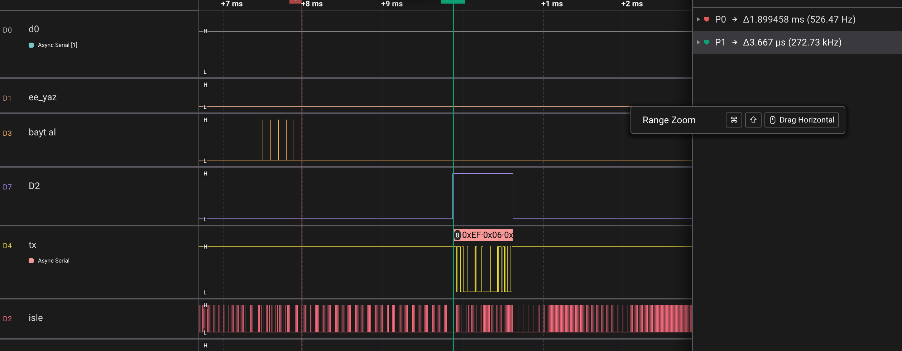
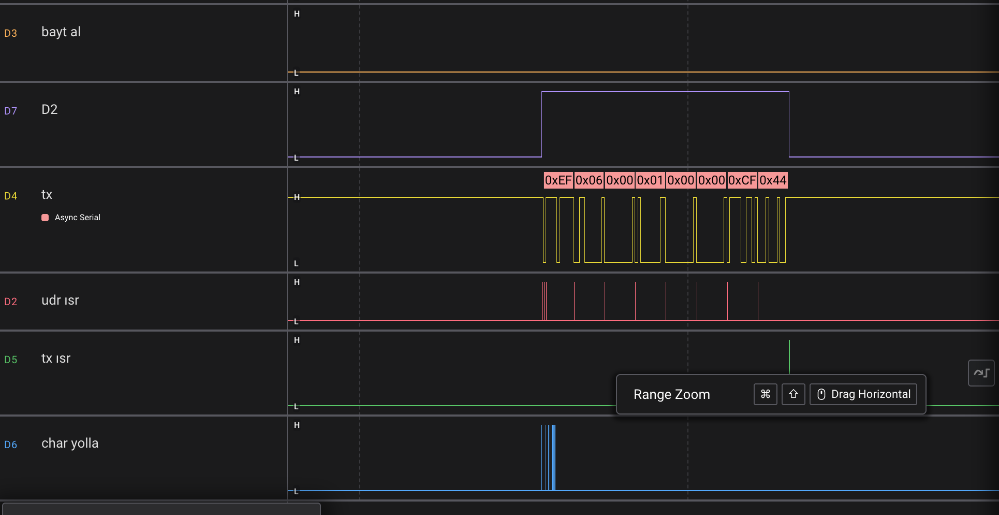
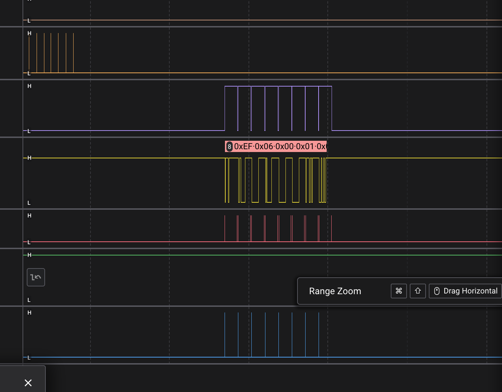
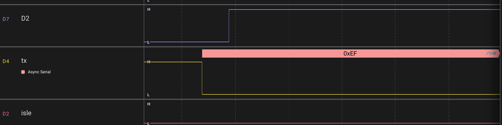
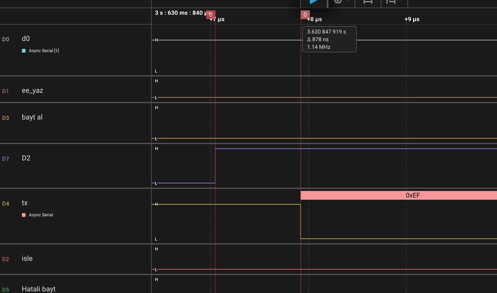
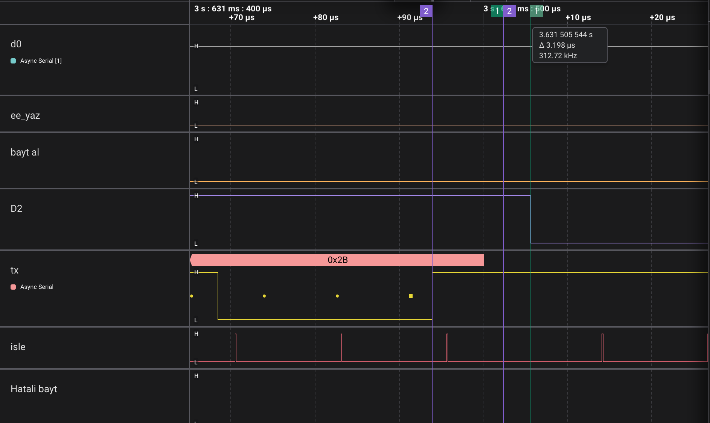

# 04/05 — RS-485: Yarı Çift Yönlü Hat ve DE Kontrolü

> ATmega328P (Arduino Uno) üzerinde bare-metal Modbus RTU slave — 5. aşama.
> Aynı Modbus kodu, MAX485 ile **RS-485 hattına** taşındı. Değişen tek modül `uart.c`:
> vericiyi açıp kapatan **DE** pini ve onu doğru anda indiren **TXC kesmesi**.

---

## Bu aşamada ne değişti?

| Konu | 04/04 | 04/05 |
|---|---|---|
| Fiziksel katman | TTL (CH340 üzerinden USB) | **RS-485** (MAX485 ↔ FT232 USB-RS485 dönüştürücü) |
| Hat | Tam çift yönlü (TX ve RX ayrı tel) | **Yarı çift yönlü** (tek A/B çifti, aynı anda tek konuşan) |
| Gönderim sonu | Bilinmesine gerek yoktu | **TXC kesmesi** → DE = LOW |
| Gönderim başı | — | DE = HIGH, sonra gönderim |
| `modbus.c` | — | **Hiç değişmedi** |

---

## Donanım

```
Mac ── USB ── FT232 (USB-RS485) ══ A/B ══ MAX485 ── RO → D0 (RX)
                                                └── DI ← D1 (TX)
                                                └── DE+RE ← D2
```

| MAX485 | Arduino | Not |
|---|---|---|
| VCC / GND | 5V / GND | |
| RO | D0 (RX) | **Kod yüklerken sökülmeli** (aşağıya bak) |
| DI | D1 (TX) | |
| DE + RE | D2 | Birlikte bağlı: HIGH = konuş, LOW = dinle |
| A / B | Dönüştürücüde A+ / B− | Etikete göre bağla |

**Kurallar (zor yoldan öğrenildi):**
- Kablo değiştirmeden önce **USB'yi çıkar**. Enerji varken tak-çıkar yapılan iki modül ısındı.
- Pin sırasına değil, **modülün üstündeki etikete** göre bağla.
- Uno'da D0 hem CH340'a hem RO'ya bağlı. Yükleme sırasında ikisi aynı teli sürer → bootloader bozuk bayt alır. RO'yu sök, yükle, geri tak.

---

## Neden TXC? UDRE ile farkı

UART'ın içinde baytın durabileceği iki yer var:

```
rbtx (yazılım tamponu) ──ISR──► UDR0 (tezgah, 1 bayt) ──otomatik──► kaydırma yazmacı ──► TX pini
```

| Bayrak | Ne zaman kalkar | Anlamı |
|---|---|---|
| **UDRE** | Tezgahtaki bayt kaydırma yazmacına geçince | "Sıradakini koy." Bayt **henüz hatta çıkmadı.** |
| **TXC** | Kaydırma yazmacı son bitini çıkardığında **ve** tezgah boşsa | "Son stop biti dahil her şey hatta." |

DE son UDRE kesmesinde indirilseydi, o anda kaydırma yazmacına yeni geçmiş olan **son bayt (CRC_H) hatta çıkamazdı.**

### Akış

```c
// send_char: bayt tampona → (paketin ilk baytıysa) DE = HIGH → UDRIE açılır
ISR(USART_UDRE_vect) {               // tampon doluysa: tezgaha koy; boşsa: UDRIE kapat
  ...
}
ISR(USART_TX_vect) {                 // kaydırma yazmacı + tezgah boş → paket bitti
  if (pin_low) pin_low();            // DE = LOW
  flag = 1;                          // sonraki paketin başında DE yeniden açılsın
}
```

`TXCIE0` init'te bir kez açılıyor; böylece bekleyen eski bir TXC bayrağı yeni paketin başında DE'yi indiremiyor.
DE pini callback (`pin_high` / `pin_low`) olarak veriliyor; `uart.c` hangi pin olduğunu bilmiyor.

---

## Ölçümler (Saleae Logic 2)


*8 baytlık `06` isteği (bayt al darbeleri) → ~1.9 ms sonra cevap. DE (D2) cevabı tam kapsıyor.*

| Ölçüm | Değer | Gereken | |
|---|---|---|---|
| İstek sonu → cevap başı | **1.90 ms** | ≥ t3.5 (1.75 ms) | ✅ ~150 µs işleme |
| DE ↑ → ilk start biti | **3.67 µs** önce | > t<sub>ZL</sub> (MAX485, en fazla 70 ns) | ✅ |
| Son stop biti sonu → DE ↓ | **3.2 µs** sonra | > 0 | ✅ |

**3.2 µs nereden geliyor?** 16 MHz'de ≈ 50 çevrim: kesmeye giriş + `jmp` + callback (`icall`) yüzünden ~16 register yedekleme + `pin_low`.
04/04'te objdump'ta sayılan push/pop'lar burada zaman olarak ölçüldü.

### Deney 1 — UDRE ve TXC ne zaman geliyor?
UDRE ve TXC ISR'lerinin başına debug darbesi kondu.



- Başta **iki** UDRE yan yana (tezgah + kaydırma yazmacı ikisi de boş).
- Sonra her bayt sınırında **bir** UDRE.
- 8 bayt için **9** UDRE: sonuncusu bayt koymuyor, tamponu boş bulup kesmeyi kapatıyor.
- TXC paket boyunca **hiç yok**, sadece en sonda **bir kez** → DE iniyor.

### Deney 2 — ISR yavaşlarsa?
UDRE ISR'ine geçici `_delay_us(150)` eklendi (bir bayt süresi ~95 µs).



- Kaydırma yazmacı her bayttan sonra tezgahı boş buluyor → baytlar arasında boşluk.
- TXC **her bayttan sonra** geliyor → DE paket ortasında 8 kez iniyor ve `flag` sayesinde yeniden kalkıyor.
- Main de yavaşladı: uzun ISR, `send_char` çağrılarını da bekletiyor.

---

## Hata hikâyeleri

**1. Hattan tek bayt geçmiyordu.** A/B'ye gerilim ölçümleri, modül değişimi, loopback denemeleri…
Sonunda bağlantının baştan yanlış takıldığı anlaşıldı. Ders: **bir anda tek değişiklik yap ve her denemeyi tek satır not al.**

**2. DE geç açılıyordu ama sistem çalışıyordu.** İlk sürümde `pin_high()`, UDRE ISR'inde `UDR0 = …` satırından **sonra** çağrılıyordu.
Analizörde start biti DE'den **~1 bit (8.7 µs) önce** başlıyordu: start biti kapalı vericiden çıkıyordu.
Çalışmasının sebebi şans: boştaki hat sürülmüyordu (A = B), dönüştürücü bunu 0 okudu ve start bitini "kendiliğinden" gördü.
Bias dirençli bir hatta boş hat 1 okunur ve ilk bayt bozulurdu.

| Sürüm | DE ↑ → start | Durum |
|---|---|---|
| `pin_high()` UDR0'dan sonra | **−8.7 µs** (start önce) | ❌ |
| `pin_high()` UDR0'dan önce | +878 ns | ✅ ama pay tesadüfi |
| `pin_high()` `send_char`'da | **+3.67 µs** | ✅ |


*Hatalı sürüm: tx'te start biti başlıyor, DE ancak ~1 bit sonra yükseliyor.*


*İlk düzeltme: DE, start bitinden 878 ns önce yükseliyor.*


*Bitiş: son baytın stop biti bittikten 3.2 µs sonra DE iniyor.*

---

## Bilinen sınırlamalar

- **DE payı CPU hızına bağlı.** 3.67 µs, 16 MHz'e özel. Payı ölçmek yetmez, tasarlamak gerekir: STM32'nin USART'ındaki donanım **DEM** (DEAT/DEDT) bunu yazılımsız çözüyor.
- **Yarış penceresi:** `pin_high()` ile `UDRIE0`'ın açılması arasında, önceki paketin son baytı bitip TXC gelirse yeni paket kapalı vericiden çıkar.
  Modbus'ta oluşmaz: slave yalnızca isteğe cevap verir; iki cevap arasında en az ~2.5 ms (istek + t3.5) var, pencere ise < 95 µs.
  Arka arkaya gönderen genel amaçlı bir sürücüde kritik bölge + TXC bayrağı yönetimi gerekir.
- **D0 boşta kalıyor:** DE = RE HIGH iken RO yüksek empedansa geçer. Uno'da CH340 hattı HIGH tutuyor; CH340'sız bir kartta RO'ya **pull-up** gerekir.
- **Bias / sonlandırma yok:** Boştaki hat A = B (≈ 1.8 V). Kısa masa testinde sorun yok; uzun hatta 120 Ω sonlandırma ve bias dirençleri eklenmeli.

## Sırada
**04/06 — Sensör düğümü:** NTC / LM35 okumasını Modbus register'larına açmak; RS-485 üzerinden gerçek bir ölçüm cihazı.
