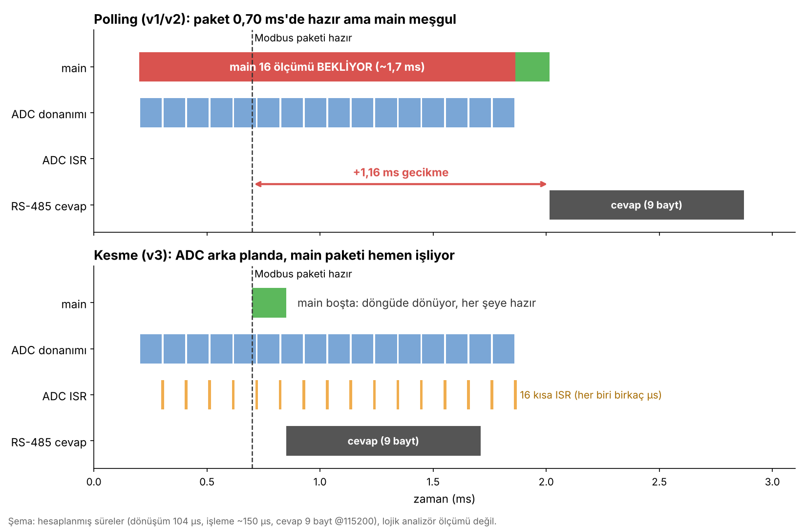
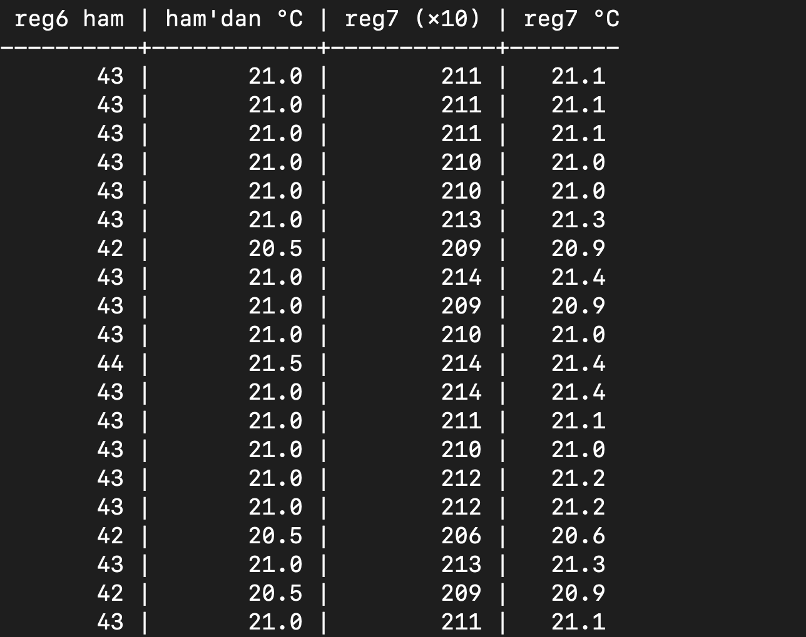
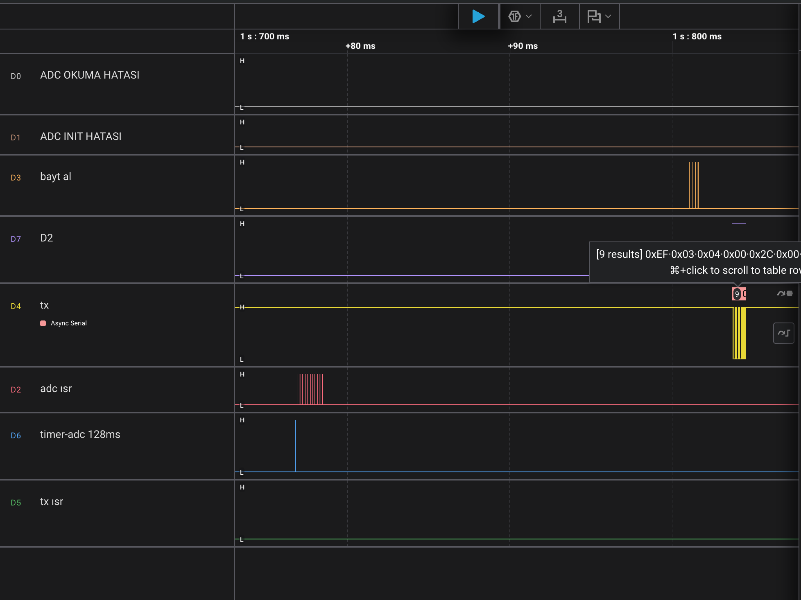
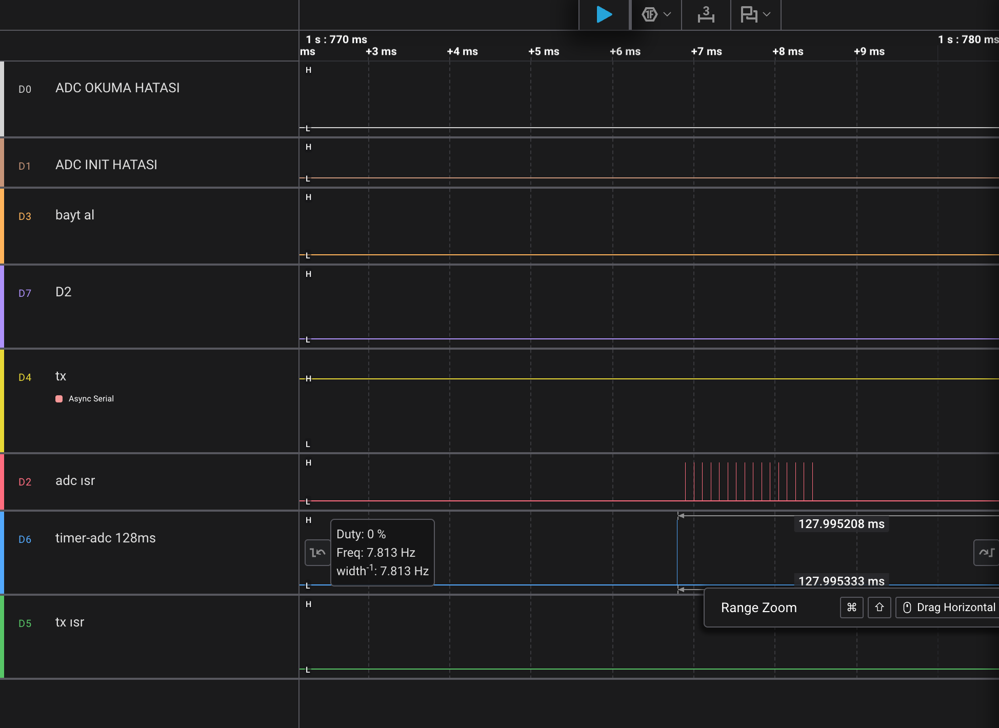
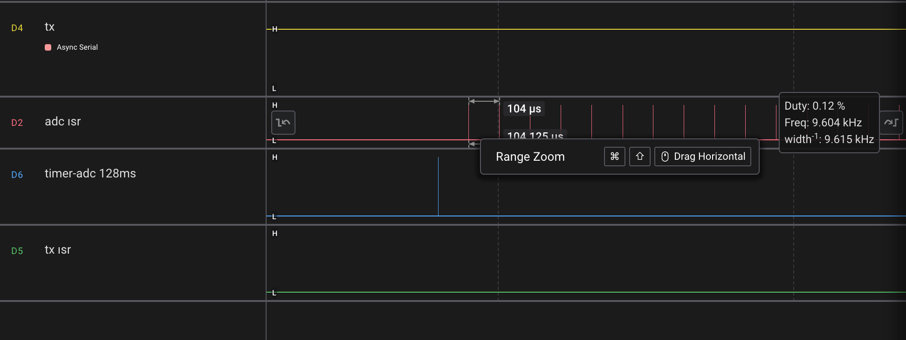

# 04/06 — ADC ile Sıcaklık Düğümü (LM35 → Modbus)

> ATmega328P (Arduino Uno) üzerinde bare-metal Modbus RTU slave — 6. aşama.
> Register seviyesinde yazılmış bir **ADC sürücüsü** ile LM35 sıcaklık sensörü okunuyor ve
> RS-485 üzerinden Modbus register'larına açılıyor. Aynı ölçüm **üç farklı yöntemle** yazıldı:
> bekleyerek (ADSC), bayrağa bakarak (ADIF) ve **kesme + timer callback'i** ile.

---

## Register haritası (güncel)

| Reg | İçerik | Birim / Ölçek | Erişim |
|---|---|---|---|
| 0 | Kimlik `0xEFE1` | — | R |
| 1 | LED (0/1) | — | R/W |
| 2 | Uptime taşma sayacı | 49,7 günde +1 | R |
| 3 | Uptime ms — üst 16 bit | ms | R |
| 4 | Uptime ms — alt 16 bit | ms | R |
| 5 | Slave adresi (EEPROM'da kalıcı) | 1–247 | R/W |
| **6** | **Ham ADC ortalaması** (16 ölçüm) | 0–1023 | R |
| **7** | **Sıcaklık** | **0,1 °C** (`210` = 21,0 °C) | R |

Modbus register'ı 16 bitlik bir tam sayı olduğu için sıcaklık **sabit noktalı** (×10) gönderiliyor;
master okuduğu değeri 10'a böler. Reg 7 işaretli (`int16`) yorumlanmalı.

---

## Donanım

| LM35 bacağı (yazılı yüz sana bakarken, soldan sağa) | Bağlantı |
|---|---|
| +Vs | 5 V |
| Vout | **A0** (ADC0) |
| GND | GND |

LM35 çıkışı: **10 mV / °C** (25 °C → 250 mV).

---

## ADC nasıl ölçüyor? (kısa teori)

**SAR — ardışık yaklaşım:** ADC, girişi 10 adımda bir "terazi" ile tartar: her adımda bir biti
"büyük mü, küçük mü?" diye belirler (512 → 256 → … → 1). 10 bit → **1024 basamak**.

| Kavram | Değer |
|---|---|
| Referans | AVCC = 5 V |
| Çözünürlük (LSB) | 5000 mV / 1024 ≈ **4,88 mV** ≈ **0,5 °C** (LM35'te) |
| ADC saati | 16 MHz / 128 = **125 kHz** (datasheet: 50–200 kHz) |
| Bir dönüşüm | 13 ADC saati ≈ **104 µs** (ADC açıldıktan sonraki ilk dönüşüm 25 saat) |

**Referans "cetvelin boyu":** 1,1 V dahili referansla LSB 1,07 mV olur (daha hassas) ama ~1,1 V'tan büyük
gerilim ölçülemez. Bu aşamada 5 V seçildi.

---

## Sürücü (`adc.c`)

`Usart` ve `Modbus` ile aynı yapı: fonksiyon pointer'lı bir struct (`ADC0`), durum kodu döndüren fonksiyonlar.

```c
typedef enum { ADC_OK, ADC_KAPALI, ADC_HATA_ZAMAN_ASIMI, ADC_PRESCALER_HATA,
               ADC_INIT_OK, ADC_ZAMAN_FONKSIYONU_VERILMEDI, ADC_MESGUL } AdcDurum_t;
```

- **Init**, bölücünün 50–200 kHz aralığında olup olmadığını kontrol eder; değilse sessizce dönmek yerine
  `ADC_PRESCALER_HATA` döndürür.
- **Kanal**, ADMUX'un diğer alanlarını bozmasın diye `& 0x0F` ile maskelenir.
- Bekleyen sürümlerde **zaman aşımı** (500 µs) var: donanımı bekleyen her döngünün bir çıkışı olmalı.

---

## Üç sürüm

### Sürüm 1 — ADSC'yi beklemek
```
ADSC = 1  →  ADSC 0 olana kadar bekle (en fazla 500 µs)  →  ADC'yi oku
```
ADSC bir **durum** biti: donanım ölçüm bitince onu kendisi 0 yapar; temizlik gerekmez.

### Sürüm 2 — ADIF'i beklemek
```
ADIF'i temizle  →  ADSC = 1  →  ADIF 1 olana kadar bekle  →  oku  →  ADIF'i temizle
```
ADIF bir **olay** bayrağı: ölçüm bitince 1 olur ve **1 yazılarak** silinir. Temizlenmezse bir sonraki
ölçümde eski "bitti" bilgisiyle hemen çıkılır.

> **Tuzak:** `ADCSRA |= (1<<ADSC);` satırı ADCSRA'yı okuyup geri yazdığı için, ADIF 1 ise ona da 1 yazar ve
> bayrağı **kazara temizler**. ADIF'e dokunmadan başlatmak için:
> `ADCSRA = (ADCSRA & ~(1<<ADIF)) | (1<<ADSC);`

Sürüm 1 ve 2'de main, 16 ölçümlük seri boyunca (~1,7 ms) bekler. Kesmeler çalışmaya devam ettiği için
UART baytları kaybolmaz, ama main o süre boyunca başka iş yapamaz.


*Şema (hesaplanmış, ölçüm değil): Modbus paketi main beklerken hazır olursa cevap, bekleme bitene kadar
gecikir. En kötü durumda bu gecikme ~1,7 ms. Kesmeli sürümde ölçüm arka planda sürerken main paketi hemen işler.*

### Sürüm 3 — Kesme + timer callback'i ✅ (kullanılan)

```
TIMER0 ISR (her 1 ms)   → (ms & 0x7F) == 0 ise callback() → ADSC = 1         ← BAŞLATIR (128 ms'de bir)
ADC donanımı (~104 µs)  → ölçer, ADIF = 1                                      ← ÖLÇER
ISR(ADC_vect)           → toplama ekle; 16'dan azsa yeni ölçüm başlat,         ← TOPLAR
                          16 olunca toplamı yaz, hazir = 1
main                    → hazir ise kritik bölgede oku → reg 6 / reg 7
```

- **Callback'in yönü:** "128 ms doldu" olayını ilk fark eden **timer** olduğu için callback timer'da durur.
  `timer.c` ADC'yi, `adc.c` timer'ı tanımaz; ikisini `main` bağlar:
  `init_timer0(adc_olcum_baslat_);`
- **Neden 128 ms?** 2'nin kuvveti: ayrı bir sayaç ya da pahalı `% 100` yerine tek bir maske
  (`& 0x7F`) yetiyor; 2³² de 128'in katı olduğu için sayaç sarınca ritim bozulmuyor.
- **ISR → main teslimi:** ISR önce **değeri**, en son **bayrağı** yazar. Main bayrak ile değeri
  **tek kritik bölgede** okur (SREG sakla → `cli` → oku, bayrağı indir → SREG geri yükle).
  Paylaşılan iki değişken (`hazir_flag`, `adc_sonuc`) `volatile`.

---

## Sıcaklık ve oversampling

ISR 16 ölçümün **toplamını** saklıyor; main iki değer hesaplıyor:

```c
uint16_t ham          = toplam >> 4;                       // reg 6
uint16_t sicaklik_x10 = (uint32_t)toplam * 5000 / 16384;   // reg 7, mV = °C × 10
```

- `uint32_t` şart: 16 368 × 5000 ≈ 82 milyon.
- Hesap ISR'de değil main'de: 32 bit çarpma/bölme yüzlerce çevrim.
- **Neden toplam?** Önce 16'ya bölüp tam sayıya kesmek, 16 ölçümün topladığı kesir bilgisini atar.
  Toplamdan hesaplayınca bir basamak 4,88 mV yerine **0,305 mV** oluyor.


*Reg 6 (ham ortalama) 42–44 arasında 0,5 °C'lik basamaklarla zıplarken, reg 7 toplamdan hesaplandığı
için 0,1 °C adımlarla değişiyor.*

---

## Ölçümler (Saleae Logic 2)


*Timer callback'i (D6) → ADC ISR serisi (D2) → çok sonra gelen Modbus isteği ve cevabı. Ölçüm, Modbus
akışından tamamen bağımsız arka planda yapılıyor.*





| Ölçüm | Değer | Beklenen |
|---|---|---|
| Timer callback periyodu | **127,99 ms** | 128 ms |
| Ardışık ADC ISR'leri arası | **103,6 µs** | 13 × 8 µs = 104 µs |
| Callback → ilk ISR | **101,9 µs** | ~104 µs (debug darbelerinin yeri ve ADC saat hizalaması ±birkaç µs) |
| 16 ölçümlük seri | ~1,7 ms | 16 × 104 µs |

---

## Hata hikâyesi: üç sorun üst üste

İlk denemede reg 6 hep 0 ya da anlamsız değerler gösterdi (GND'de 11, 3,3 V'ta 0). Üç ayrı sorun üst üste
binmişti; her katman ayrı ayrı doğrulanarak ayıklandı:

| Adım | Yöntem | Sonuç |
|---|---|---|
| 1 | Reg 6'ya sabit **1234** yaz | Yükleme ve Modbus yolu sağlam |
| 2 | Main'deki bloktan sabit **777** gönder | Blok çalışıyor |
| 3 | **Register dökümü:** `(ADCSRA << 8) \| ADMUX` | `0x8700` → **ADMUX = 0x00**: referans AREF (test sırasında init'e yanlış parametre girilmişti) |
| 4 | Hata kodunu dışarı taşı (`0xE000 \| durum`) | Ölçüm başarılı ama sonuç 0 |
| 5 | Multimetre | **A0 kablosu GND'ye gidiyormuş** |

Ayrıca `modbus.c`'de reg 6'ya değer `/10` ile yazılıyordu; değerler 10 kat küçük görünüyordu.

**Dersler:**
- "Ne ayarladığımı sanıyorum" yerine **register'da gerçekte ne var** diye bak.
- "Ölçüm 0" ile "hiç ölçüm yok"u ayırt etmek için hata kodunu dışarı taşı.
- Hata ayıklarken yapılan değişiklikler yeni hatalar sokabilir: test bitince kodu eski haline döndür.

---

## Bilinen sınırlamalar
- **Çözünürlük:** 5 V referansla LM35 için tek ölçüm ~0,5 °C; oversampling ile ~0,1 °C'ye iniyor.
  Daha hassas ölçüm için 1,1 V referans.
- Timer ISR'inde callback (`icall`) olduğu için her 1 ms'de register yedekleme maliyeti ödeniyor
  (işlemci zamanının ~%0,3'ü).
- Sensör bağlantısı kopuksa ya da kısa devreyse bunu ayırt eden bir kontrol yok (ör. değer 0 ya da 1023'e
  yapışırsa hata register'ı).

## Sırada
- ADC'nin **otomatik tetikleme** modu (ADATE + Timer0 Compare Match): ölçümü yazılım değil donanım başlatır.
- **04/07 — Motor düğümü:** Timer/PWM + enkoder + PID ile hız kontrolü, Modbus üzerinden hız ayarı.
